# HiFi Lite: how it was designed

This is the full record of how the HiFi Lite was made, from the first product
brief to five working boards on a bench. It covers the hardware, the
firmware and the web app, the 3D-printed case, the bring-up and testing, and
what we would do differently.

The Lite was designed by AI agents built on Claude, working as a team under
the direction of one person. One group of agents designed the board in late
October 2026; a second group took it over on 31 October and carried it
through the pre-order reviews, ordering, firmware, bring-up and the test
lab. The agents wrote the schematic as code, placed and routed the board,
ran the simulations and checks, reviewed each other's work, wrote and tested
the firmware, generated the case from the board file and ran the bench over
a remote connection. The person set the goals, approved the order, paid for
it, and did the hands-on steps: unboxing, plugging in, listening, and saying
when something sounded wrong. [docs/who-did-what.md](docs/who-did-what.md)
separates the person's part from the agents', and
[docs/agentic_flow.md](docs/agentic_flow.md) shows how the agents organised
the work, with a timeline and what their runs cost.

Nothing here is cleaned up after the fact. Where a check missed something,
or a board misbehaved on the bench, the chapter says so and says what was
changed. Every file referred to is in this repository; the agents' own
working notes are kept as written (see "Reading the working docs" in the
[README](README.md) for the few local words they use).

The chapters:

1. **Timeline**: what happened when.
2. **Hardware**: requirements, architecture, part choices, the schematic,
   placement and routing, simulations, check gates, design reviews, BOM and
   ordering, and the next spin.
3. **Firmware and app**: why squeezelite-esp32, the patch series, our own
   component, audio sources, OTA updates, memory and security work, party
   mode, tests, and the web app.
4. **Enclosure, bring-up, testing and lessons**: the case in code, first
   power-up, the measurements, and what the project taught.

The last section collects the questions the sources did not settle.

## Contents

- [1. Timeline](#1-timeline)
- [2. Hardware](#2-hardware)
  - [What the Lite is and what it must do](#what-the-lite-is-and-what-it-must-do)
  - [Block architecture](#block-architecture)
  - [Key part choices](#key-part-choices)
  - [The schematic](#the-schematic)
  - [Stackup, placement and routing](#stackup-placement-and-routing)
  - [Simulations](#simulations)
  - [Check gates](#check-gates)
  - [Design reviews and pre-order rounds](#design-reviews-and-pre-order-rounds)
  - [BOM, cost and ordering](#bom-cost-and-ordering)
  - [What we would change next spin](#what-we-would-change-next-spin)
- [3. Firmware and app](#3-firmware-and-app)
  - [Why squeezelite-esp32](#why-squeezelite-esp32)
  - [The patch series](#the-patch-series)
  - [The hifi component](#the-hifi-component)
  - [Audio sources and how they hand over](#audio-sources-and-how-they-hand-over)
  - [OTA, signing, trial boot and recovery](#ota-signing-trial-boot-and-recovery)
  - [Memory work](#memory-work)
  - [Security hardening](#security-hardening)
  - [Party mode](#party-mode)
  - [Tests](#tests)
  - [The web app](#the-web-app)
- [4. Enclosure, bring-up, testing and lessons](#4-enclosure-bring-up-testing-and-lessons)
  - [Enclosure](#enclosure)
  - [Bring-up](#bring-up)
  - [Testing and characterisation](#testing-and-characterisation)
  - [Lessons learned](#lessons-learned)
- [Open questions](#open-questions)

## 1. Timeline

Dates are 2026 and come from commit history, pull requests and the project's working notes. Where no source gives a date, none is given. The board was designed in late October by one group of AI design agents. From 2026-10-31 a second group carried it through the pre-order review, ordering, firmware, bring-up and the test lab.

| Date | Event |
|---|---|
| Oct 28 | Repository set up and product defined. The 2-layer `lite-main` board placed, routed and verified, and a JLCPCB fabrication and assembly package produced. The CH224Q PD sink was swapped for the CH224A because it would not route on 2 layers. EasyEDA footprints were fixed (20 of 21 courtyards too small). First enclosure commit. |
| Oct 29 | Enclosure refit to the final `lite-main` outline. |
| Oct 30 | Independent review rounds by review agents that did not do the design; board declared order-ready. Enclosure made printable without supports. |
| Oct 31 | Work handed to the second group. ESD clamps added (PR #133). Lite output power capped at 60–65 W by the 20 V PD supply (PR #136). Fourth review round. |
| Nov 1 | Pre-order review round (PR #152); enclosure hole axes fixed. |
| Nov 4 | Bring-up plan written and merged (PRs #162, #163; `docs/bringup.md`). Signal-integrity gates (PR #167), circuit simulations (PR #164) and order-readiness checks (PRs #170, #172). |
| Nov 5 | Ground stitching increased from 130 to 403 vias; antenna keep-out bands. Enclosure antenna keep-out and Bambu A1 mini slicing (PR #175; 43/43 fit checks). Order placed at JLCPCB: 10 bare PCBs and 5 assembled boards, USD 269.35 with DHL shipping. |
| Nov 6 | Mounting hole H4 changed to 3.2 mm NPTH (PR #176); enclosure rebuild byte-identical. |
| Nov 8 | USB-C connector J1 current-rating waiver recorded (PRs #181, #182). |
| Nov 15 | Boards expected soon. Web-serial "plug in a board" page built so the owner's laptop could give the agents a console. |
| Nov 16 | First power-up, on Lite 1 over laptop USB. Firmware fixes for an empty `ota_data`, an I2C start-up race, console line loss and low heap (PR #185). First Wi-Fi join. First sound on a 20 V PD charger: a 440 Hz tone, left/right, a sweep and a tune. All five boards brought up. First enclosure printed in PLA. Loose button plungers failed and were replaced by spring tongues in the lid ("Lid buttons work great"). Lid labels added (PR #186). |
| Nov 16–17 | Further firmware faults found and fixed: rename not saved, Bluetooth pairing panic (timer pool), a keyless test build locking Lite 2 out of Wi-Fi updates, Spotify takeover and skip lag, Bluetooth visibility, next/previous freeze. |
| Nov 17 | All five boards became lab boards. 230 commits that day. Security review (PR #190); fuzzing (PRs #187, #201); QEMU fault scenarios (PR #191); self-test reports for all five boards; `hifi_relay` stack raised (PR #192). Lite 3 soak from 03:11, ended at 7.7 h by a USB-C plug shift; reconnect leak found and fixed. Audio loopback measurements on Lites 2–4 (PR #219). Hardware-in-the-loop 37/37 on Lite 5. Screwless snap box v1 printed and did not latch; v2 committed (e66f2d7). Next-spin hold-up and connector advice written. |
| Nov 18 | First nightly hardware-in-the-loop run (71/74; the 3 failures were fixed in PR #250). App first draw 470 → 296 ms (PR #246). Update download 39 → 76 KB/s (PR #254). User-path tests 45/45 (PR #247). First-boot loopback failure fixed (PRs #253, #257, #259; then 25/25). App power graphs (PR #248). Lite 1 boot heap cut from 46,287 to 39,643 B. Main branch synced (PR #260). |

## 2. Hardware

This chapter covers the Lite main board: what it had to do, how it was designed, which checks it passed, what those checks caught, and what we would change on the next spin. The board was designed by AI agents. One agent group did the board design in October 2026, and a second took the work over from 2026-10-31 through ordering, bring-up and the power-loss work. The tools were hwde/hive-pcb-flow, a scripted flow around KiCad 10, with JLCPCB as fab and assembler, squeezelite-esp32 as the firmware base, and a remote bench for measurements. Five boards were built, called Lite 1..5 below.

### What the Lite is and what it must do

The Lite is the cheapest of three tiers of a small streaming amplifier. It takes audio over Wi-Fi (through squeezelite-esp32) and Bluetooth A2DP, plus a line-level analogue input, and drives a pair of passive speakers. It is powered from a USB-C laptop charger.

#### Why a cheap tier

`docs/product.md` puts the Lite first for two reasons. It is the lowest-risk board: one MCU module, one codec, one class-D amplifier, all well-known parts with reference designs. And it fixes the price floor of the range: retail was set at $59 to $79, so the board has to cost well under $20 in parts and assembly at volume. The product page's target was $14.79 per board at 100 units and $23.41 at 10 units.

The features left out of the Lite were cut because of cost, not because they were hard: Ethernet, the Sabre DAC, USB PD EPR (above 20 V), and bass management. Those belong to the higher tiers.

#### Inputs and outputs

| Function | Implementation |
|---|---|
| Power in | USB-C, USB PD at 20 V from a 65 to 100 W charger |
| Network | Wi-Fi 2.4 GHz (ESP32 module) |
| Bluetooth | Classic BT, A2DP sink |
| Analogue in | RCA stereo line input (J2) |
| Sub out | RCA line-level subwoofer output (J3) |
| Speaker out | 2 channels BTL, four banana sockets (J4 to J7) |
| Controls | 3 front buttons, IR receiver, one status LED |
| Service | USB-UART on the same USB-C port (CH340B), 8-pin header J8 |

#### Power budget

The amplifier rail runs directly from the 20 V PD contract. The product page states 43 W per channel peak into 4 Ω at 20 V. That figure was calibrated against a 12 V TPA3118 board on the bench, which measured 10.9 W into 6 Ω; the 20 V figure scales from that measurement, it is not a direct one. The continuous rating is set by heat, not by the supply: a later review found the board can hold about 9 W per channel for 30 s before the amplifier reaches its thermal limit (see Simulations). Firmware enforces this with a power governor. A design review calculated 38.7 W per channel into 4 Ω at 1 % THD from an unlimited 20 V supply; that is not measured either. On a 65 W charger the governor allows about 49 W in total for short bursts and 9 W per channel sustained by default (up to 15 W per channel in the app).

A charger at 5 V only (no PD) powers only the ESP32 side, so the board can still be set up and updated. The amplifier stays off.

#### Why these core chips

The MCU choice was forced by Bluetooth. The ESP32-WROVER-E-N8R8 is the only cheap chip with Bluetooth Classic, which A2DP needs. The ESP32-S3 and ESP32-C5 support only BLE. Linux SoCs that could do everything cost $17 to $25 for the SoC alone, which breaks the budget. A ready-made Linkplay streaming module was also considered and rejected.

The codec is the ES8388 at $0.71. It matches the ESP32-A1S audio module's pin map, so squeezelite-esp32 supports it without driver work, and it has an analogue bypass path that the line input can use. The amplifier is the TPA3118D2 at $0.81, a 2-channel class-D chip rated to 26 V supply, which leaves headroom above a 20 V PD rail.

### Block architecture

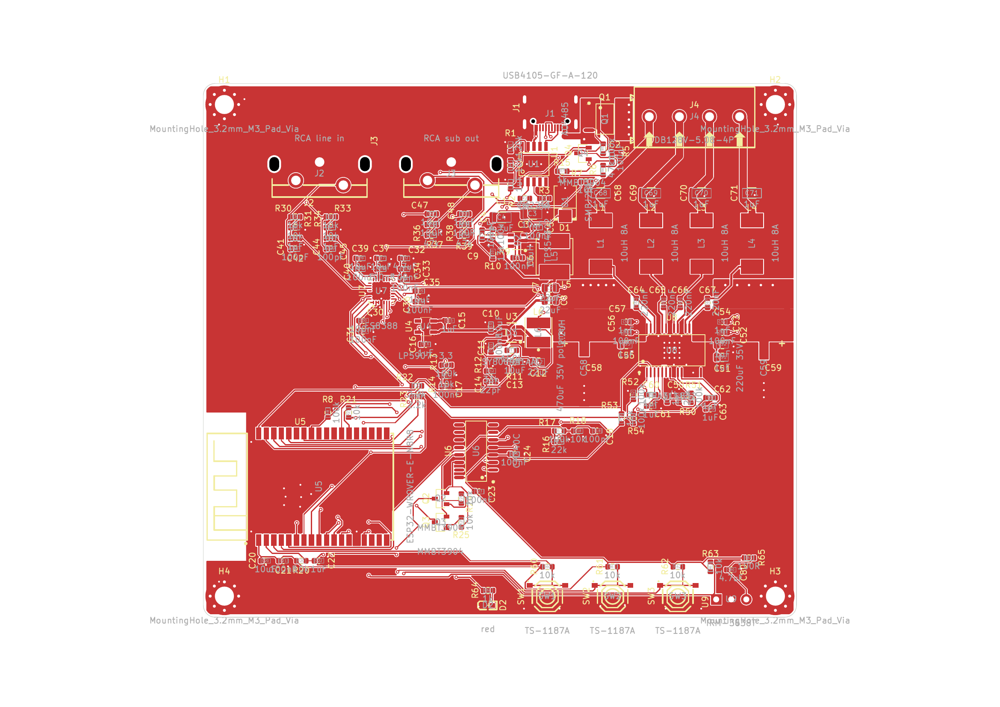
*The Lite main board, top: all 154 parts on one side, connectors along the rear edge*

The architecture is in `hardware/architecture/` (`blocks.md`, `stackup.md`, `sheets.md`) and the design brief in `hardware/brief/brief.md`. The design is one flat root sheet with 11 blocks.

```
USB-C J1 ──► TVS ──► CH224A PD sink (20 V request) ──► VBUS
                │                                   │
                │                                   ├─► Q1 PVDD switch (GPIO18 AND PG) ──► PVDD ──► TPA3118D2 (U8) ──► L1..L4 ──► J4..J7
                │                                   │
                │                                   └─► TPS54302 buck 5.18 V ──► SY8089 3V3 (digital)
                │                                                           └─► LP5907 3V3 (analogue, codec)
                └─► USB D+/D- ──► CH340B ──► ESP32 UART0 (flashing, console)

ESP32-WROVER-E ── I2S/I2C ──► ES8388 codec ──► amp inputs, sub out J3
       ▲                          ▲
  buttons, IR, LED          RCA in J2 (ADC / analogue bypass)
```

#### Power path

The PD sink is the WCH CH224A. A single resistor on its config pin (Rset 120 kΩ) selects a 20 V request, and the chip also has an I2C interface at address 0x22. The family was chosen for cost and simplicity; the CH224K was first in the plan, but JLC had one in stock, so the design moved to the CH224Q and then to the CH224A (same die, 1.0 mm pitch package) because the CH224Q's DFN could not be fanned out on a 2-layer board.

The amplifier rail PVDD does not connect directly to VBUS. A P-channel MOSFET Q1 (AO4485) driven by an NPN Q4 (MMBT3904) switches it, and the switch only turns on when the firmware drives GPIO18 high AND the CH224A reports power-good. This means the amplifier never sees 5 V or a half-negotiated rail, and a renegotiation drops it at once. The switch has a soft start of about 28 ms that limits the inrush into the amplifier's bulk capacitors to about 0.41 A.

The logic rails come from a TPS54302 buck set to 5.18 V, followed by an SY8089 buck to 3.3 V for the ESP32 and digital parts, and an LP5907 LDO to a separate analogue 3.3 V for the codec. The bulk capacitance on PVDD is a 470 µF polymer plus a 220 µF capacitor.

#### Audio path

The ESP32 drives the ES8388 over I2S and controls it over I2C, using the ESP32-A1S pin map so squeezelite-esp32's existing configuration works. The codec's outputs feed the TPA3118D2 inputs and the sub-out RCA. The amplifier runs bridge-tied at 26 dB gain in BD modulation, with 10 µH output inductors L1 to L4. Self-measure taps bring scaled copies of the rails and outputs back to ESP32 ADC pins so the firmware can run a self-test.

#### Pin map notes

The ESP32 pin map follows the A1S layout. The IR receiver was moved to GPIO14 during schematic review. GPIO18 gates the PVDD switch. The CH224A I2C pull-ups were placed through 0 Ω links so they can be taken out.

### Key part choices

| Function | Part | Why | Alternatives considered |
|---|---|---|---|
| MCU | ESP32-WROVER-E-N8R8 (8 MB flash, 8 MB PSRAM) | Only cheap chip with BT Classic; PSRAM for squeezelite buffers | ESP32-S3, C5 (BLE only); Linux SoC ($17–25); Linkplay module (rejected) |
| Codec | ES8388 ($0.71) | A1S-compatible, firmware support exists, analogue bypass | Sabre DAC (cut to higher tier) |
| Amplifier | TPA3118D2 ($0.81) | 26 V max, 2-channel BTL, cheap, TI reference design | — |
| PD sink | CH224A | Resistor-set 20 V, I2C status, cheap | CH224K (out of stock), CH224Q (DFN could not be fanned out on 2 layers) |
| PVDD switch | AO4485 + MMBT3904 | Gated by firmware AND power-good | — |
| 5 V buck | TPS54302 | Takes 20 V+ input | — |
| 3.3 V | SY8089 (digital), LP5907 (analogue) | Low-noise LDO for the codec | — |
| USB-UART | CH340B | Built-in oscillator, buyable at JLC | CH340C (not buyable at JLC) |
| USB-C | HRO TYPE-C-31-M-12 | Buyable, assembled at JLC | USB4105 (replaced in review) |
| Input TVS | SMBJ22A | Clears a 20 V rail with margin | SMBJ20A (too close to 20.x V contract) |
| Signal ESD | PESDNC2FD5VB ×6 | $0.009 each, top side | — |
| Speaker out | Amass 24.243 banana sockets ×4 | Real PCB socket with CAD data | GC4010-F binding post (no CAD, not a PCB part), screw terminal |
| IR | IRM-3638T (U9) | Side-looking, faces out of the front edge | — |

Some of these changed during review. The second design review round changed the USB-C connector from the USB4105 to the HRO TYPE-C-31-M-12. The HRO part's rating is below the 21 V maximum the checks assume for VBUS, so this was taken as a waiver (issue #181). The CH340C was replaced by the CH340B because the C was not buyable at JLC. The input TVS was raised from SMBJ20A to SMBJ22A, giving more standoff above the 20 V rail (the checks assume up to 21 V).

The speaker connector took three tries. The first choice, the GC4010-F binding post, had no CAD data in EasyEDA and turned out not to be a PCB-mount socket at all. It became a screw terminal, and later the Amass 24.243 banana sockets at 11 mm pitch.

### The schematic

#### How it was generated

The schematic was not drawn by hand. A Python script, `hardware/kicad/gen/root.py`, builds the whole root sheet from code: it places each part, wires the nets and writes a KiCad schematic. The first version produced one A0 root sheet with 130 parts and 25 decoupling associations (each decoupling capacitor tied to the pin it serves, so the placement step can keep it close). By the time of ordering the board had 154 parts after the ESD diodes, the mute circuit and other review changes were added.

Part data lives in `hardware/parts/parts.json`. It is built from the generator's reference-to-LCSC lines plus live LCSC data (price, stock, Basic or Extended class). The board has 48 distinct LCSC parts: 29 are JLC Basic parts, which are cheaper to assemble, and 19 are Extended.

Symbols and footprints come from LCSC/EasyEDA through the flow's `lib_pull` step: 22 parts were pulled in three batches. Passives use KiCad's stock footprints. The datasheets used are listed in `hardware/parts/datasheets.md`: TI SLOS708G for the TPA3118D2, WCH V2.0 for the CH224 family, Everest rev 5.0 for the ES8388, the TI TPS54302 datasheet, the Everlight IR receiver sheet, and the ESP32-LyraT v4 schematic for the ES8388's decoupling.

#### Library problems

The pulled library needed repair before it could be trusted.

- 20 of the 21 pulled courtyards were too small: they stopped short of the pads, so the placement checker would have allowed parts to overlap. `hardware/lib/fix_courtyards.py` regenerates them from the pad extents.
- `hardware/lib/fix_footprints.py` fixed the USB4105 locating pegs and added thermal vias to the TPA3118's exposed pad. The RCA jack's pegs and courtyard were fixed by hand.
- LCSC's datasheet links returned stub pages through the network proxy, so datasheets were fetched from the vendors.
- EasyEDA started returning HTTP 403 rate-limit errors during later pulls; the export step needed three tries.
- Later, the ESD round found that the L1 to L4 inductors carried a THT attribute when they are SMD, which would have put them in the wrong assembly list. It was fixed with a footprint attribute fix.

#### Schematic checks

ERC passed with 0 errors and 0 warnings, but this result means little. Every pin in the pulled EasyEDA symbols is typed as passive, so KiCad's electrical rules check cannot find driver conflicts or unconnected inputs. The netlist audit also passed. The real check was a fresh-context schematic review by a review agent, recorded in `hardware/reports/review-schematic-response.md`. It found one error and 14 warnings.

The error was in the PVDD soft start. The first design put the soft-start capacitor from Q1's gate to its source, which does nothing to the drain slew. The reviewer's hand estimate was 20 to 40 A of inrush into the 440 µF of bulk capacitance then fitted. The first fix was a Miller capacitor (gate to drain), estimated at about 1.6 A. The second review simulated that fix and found it still at the edge of Q1's safe operating area (2.49 A, 43 W). It also found that the Miller capacitor turned Q1 on at every fast VBUS edge with the firmware off. R6 went to 220 kΩ and a gate-source hold-off capacitor C19 was added, which brings the simulated inrush to about 0.41 A. The whole sequence is in [docs/decision-trail-soft-start.md](docs/decision-trail-soft-start.md).

Of the 14 warnings, 9 were fixed or mitigated and 5 were accepted with reasons. Among them: a series resistor on the amplifier's SDZ (shutdown) line, the input TVS rating, the VBUS capacitance limit, the bleeder resistor R16 (22 kΩ), the power-good AND gate, the LP5907's output capacitor, ripple on the bulk capacitors, the LED colour (red), moving the IR receiver to GPIO14, and the CH224 pull-ups on 0 Ω links.

The second review round added more fixes: R54 from 100 kΩ to 10 kΩ, R6 at 220 kΩ with a new C19, R30 and R33 at 15 kΩ, and C9 at 47 pF.

### Stackup, placement and routing

#### Stackup

The board is 2-layer FR-4, 1.6 mm thick, 1 oz copper, with an OSP finish (chosen in the 2026-11-05 round). The outline is 118 × 90 mm. Older sources disagree: `docs/product.md` and the P5 placement digest say 100 × 90 mm. The board README is the newest source and gives 118 × 90 mm, which is the size that went to fab.

The design rules are in `hardware/kicad/lite-main.kicad_dru`:

| Rule | Value |
|---|---|
| Track width / clearance (min) | 0.127 mm |
| Via (pad / drill) | 0.6 / 0.3 mm |
| Hole-to-hole | 0.5 mm |
| Copper to board edge | 0.3 mm |
| Power net clearance | 0.15 mm |

#### Constraints file

`hardware/kicad/constraints.json` drives the placement and routing tools and the later checks. It holds:

- `power`: the current each power net carries, used to size traces and necks.
- `voltages`: VBUS and PVDD at 21 V (the 20 V contract plus tolerance).
- `diff_pairs`: empty.
- `thermal`: U8 at 2 W dissipation with 16 thermal vias.
- `blocks`: the topology of each block, so the placer keeps blocks together.
- `planes`: GND on B.Cu, VBUS and PVDD as regions.
- `placement`: the refs that must sit on the rear edge.
- `esd`: an 8 kV contact target, with exemptions.
- `si`: the drivers of the fast nets (I2S clocks).
- coating: soldermask.

#### Placement

All connectors sit on two edges. The rear edge carries J2 (RCA in), J3 (sub out), J1 (USB-C) and the four banana sockets J4 to J7. The front edge carries the three buttons, the IR receiver U9 (a side-looking part that faces out of the front) and the LED. The ESP32 module sits with its antenna at the board edge, with a 15 mm copper keep-out under and around the antenna (added in the 2026-11-05 round). The mounting hole H4, near the antenna, was made non-plated so it does not detune it.

The placement checker passed after 6 iterations. All 154 parts are on the top side. This was a cost decision made on 2026-10-31: JLC charges extra setup and handling for a second assembly side, and the only parts that might have gone underneath were the small ESD diodes.

The tool `board_init` re-centres the board when it creates it, which moved the outline off its grid; `snap_outline.py` snapped it back. The outline arcs also had to be snapped to 1 µm before the DFM step, because DFM read the outline as an open shape.

#### Power paths and pours

The routing tool's rule generator gives one track width per net, which is too coarse for nets that carry 3 A in one place and a few mA in another. So the high-current nets are copper pours, not tracks. The VBUS and PVDD pours are generated from the current values in `constraints.json` by the flow's `power.py`; power clearance was lowered to 0.15 mm with `pro_clearance.py` so the pours could pass between the pads of fine-pitch parts.

The VBUS neck, the narrowest point between the connector and the bulk capacitors, is rated 3.49 A against a 3 A need.

#### Grounding

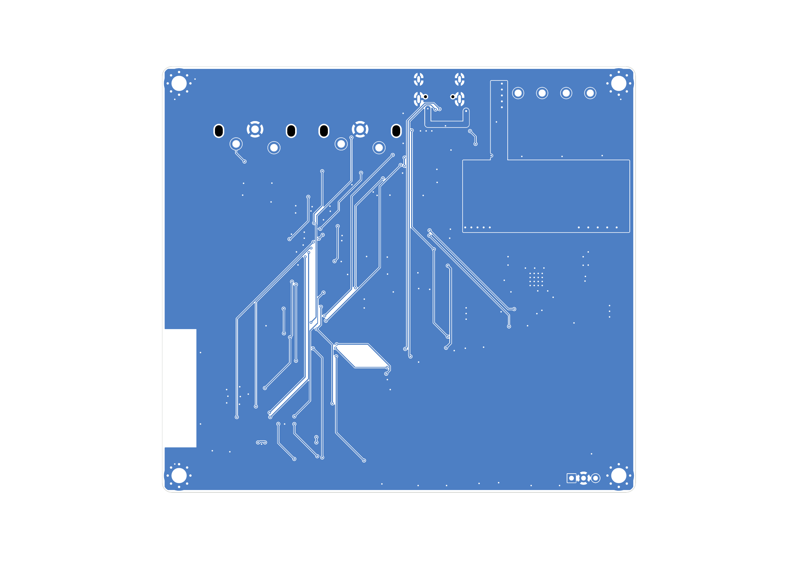
*Bottom: the B.Cu ground plane and the 403 stitching vias; no parts underneath*

B.Cu is a ground plane, broken only where tracks must cross. F.Cu has a ground pour in all the space left after routing. The two are stitched together with vias. After the project's owner saw the board render in the JLC cart, they asked about stitching. An extra 273 stitching vias were added, for 403 in total, at about 4.28 mm pitch.

The USB D+/D- pair runs on B.Cu for part of its length, and that cuts a slit in the ground plane under the bucks (see Design reviews). This is the main ground weakness of the board, and it is on the list for the next spin.

#### Thermal

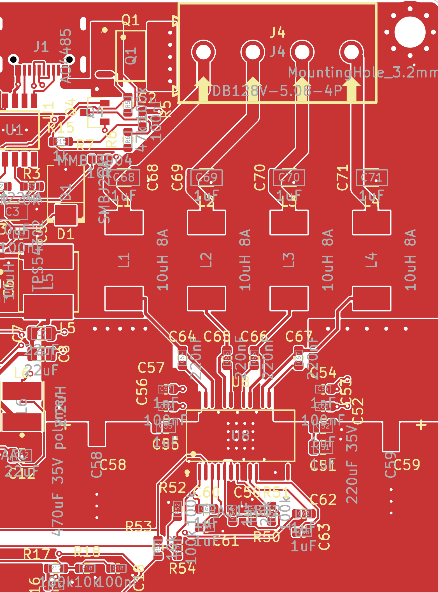
*The amplifier corner: TPA3118D2, output inductors L1-L4 and the PVDD pour*

The TPA3118D2 (U8) dumps its heat through the exposed pad into copper. The first layout gave about 62 °C/W with the PVDD pour under the chip. The B.Cu pour was pulled back 5 mm from the amplifier so the ground plane under it is unbroken, and 16 vias tie the exposed pad to it.

#### Routing method

Routing is mostly automatic, but in a fixed order:

1. `planes_gen`: B.Cu GND plane; VBUS and PVDD pours from `power.py`.
2. The self-measure taps were routed in advance, so the autorouter cannot take their paths.
3. Freerouting plus KRT for the signal nets.
4. Stitching vias.
5. The F.Cu GND pour.
6. `fix_holes`, then `plane_repair` to fix islands and slivers.
7. `snap45` to put tracks on 45° angles.

Several tool limits shaped this. Freerouting ignores non-plated holes and the hole-to-hole floor, so its output needs a hole fix afterward. It is also nondeterministic: two runs on the same board give different results. The approach was to keep the best run and then nudge individual vias by hand. The flow's `route_critical` step was skipped, because KRT shorted the critical nets into the pours. `route_edit` does not refill the pours after an edit, so `refill.py` was run after every manual change.

DRC finished at 0 errors, 0 unconnected items, 0 warnings.

### Simulations

The circuit simulations are in `hardware/sims/`; the board-level reports are in `hardware/reports/`. The aim was to check the parts of the design where a mistake could damage the board or the speakers.

#### PVDD turn-on

The soft-start simulation of Q1 in its final form (Miller capacitor C2, hold-off capacitor C19, R6 at 220 kΩ) gives:

| Quantity | Result |
|---|---|
| Peak inrush | 0.36–0.43 A |
| Peak MOSFET dissipation | 4.9–6.3 W |
| Energy in Q1 | 0.138 J |
| Time to 90 % | 72–126 ms |
| Q1 junction temperature (60 °C ambient) | 92–99 °C |

The ranges cover component tolerance. The junction temperature is within the AO4485's rating, so the slow turn-on is safe.

#### Rails

| Rail | Nominal | Range | Ripple | Limit |
|---|---|---|---|---|
| +5V (TPS54302) | 5.18 V | 5.03–5.34 V | 29–33 mV | 50 mV |
| +3V3 (SY8089) | 3.33 V | — | 9–10 mV | 50 mV |

The +5V rail's top end of 5.34 V leaves about 3 % margin to the SY8089's 5.5 V input limit. That limit was quoted from memory in the sim notes, not from the datasheet, so it is listed under Open questions.

#### Amplifier thermal

U8 at 1/8 rated power into 4 Ω was simulated at three thermal resistances:

| θJA | Ambient | Junction |
|---|---|---|
| 28 °C/W | 52 °C | 101 °C |
| 35 °C/W | 62 °C | 113 °C |
| 47.5 °C/W (hwde screen) | — | 135 / 145 °C |

The board passes at the better two values, but at the flow's conservative 47.5 °C/W model it does not. Rated continuous power fails that screen. This was accepted because the firmware governor limits output power. A later review settled the limit: the Lite can hold 9 W per channel for 30 s. At 13 W per channel the chip reaches 126 to 149 °C.

#### PVDD high-frequency loop

The loop formed by U8's PVDD pins, its local capacitors and ground has about 7.0 nH. At the edge of an amplifier over-current trip (7.5 A) this gives a simulated peak of 38.5 V on PVDD, against the chip's 30 V absolute maximum. At rated current the peak is about 26 V. The design was accepted with a bench gate: the measured spike must stay at or below 27 V, and if it does not, the fallback is a 15 V PD contract. The fix for the next spin is 1 µF capacitors right at the PVDD pins with their ground going straight to the exposed pad, which brings the loop to 2.8 nH or less.

#### I2S and output filter

The I2S bit clock overshoots to 4.03 V at the codec, a warning only. The ESP32 drive strength on the I2S pins was set to its lowest level (CAP_0). The output filter has no Zobel network, so with no speaker connected the LC filter peaks at +38.6 dB at 52 kHz. This only matters with no load and high-frequency content, and was accepted.

#### Sub-out power-loss thump

A later review simulated a power cut while playing. The sub-out RCA swung to -1.61 V, enough to make an audible thump in a powered subwoofer. A mute circuit sensing the +5V rail (Q11 to Q15, R80 to R82, C90) was added. It mutes the output as soon as +5V starts to fall, and the simulation then gives -25 mV.

### Check gates

Each step of the flow ends in a check that must pass, or be waived in writing, before the next step starts.

| Gate | Result | Notes |
|---|---|---|
| ERC | 0 / 0 | Every pin typed passive; checks nothing useful |
| Placement | Pass | After 6 iterations |
| DRC | 0 / 0 / 0 | |
| Verify | Pass, 1 waiver | U8 thermal; 27 warnings at the time, 44 later |
| DFM | 0 errors, 3 warnings | Thin silk; J2/J3 model offset |
| Current | VBUS neck 3.49 A vs 3 A | |
| ESD | 12 lines found, 6 diodes added | 10 warnings accepted |
| SI | I2S warns | 581 → 310 mV |
| Route style | 25 warnings | Track jogs |
| Wicking / EP paste | 15 → 0 | |

#### Verify

The verify gate runs a set of board checks against `constraints.json`. Its final state was a pass with one waiver and 44 warnings (25 route-style, 18 part ratings where the part had no voltage-rating attribute, and C57 placed 5.3 mm from the pin it decouples). The waiver is the U8 thermal check: the flow's model gives about 47 °C/W, while TI's EVM figure is 22 °C/W. The two figures differ by a factor of two, so bring-up has to measure it at 1/8 power.

Earlier verify rounds caught three real faults:

- BUCK5_SW, the switch node of the 5 V buck, went through a via. A switch node through a via adds inductance to the noisiest loop on the board. The buck was laid out again with SW on F.Cu only.
- The F.Cu PVDD strip was cut by the speaker output lines, so the amplifier's supply had a narrow path. PVDD was moved to a B.Cu column.
- The bleeder resistor sat on a zero-width pour sliver, so it was not really connected. It was moved.

#### DFM

DFM passed with 0 errors and 3 warnings: thin footprint silk lines, and on J2 and J3 the 3D model's pad centre 0.79 mm away from the locating pegs that had been added by hand. The second warning mattered later: the pick-and-place file must put the RCA jacks at the footprint origin, not the model centre, which was fixed in PR 165.

#### ESD

The ESD check (`check_esd`) found 12 lines that leave the board with no clamp. Six two-line PESDNC2FD5VB diodes (D3 to D8, $0.009 each) were added, all on the top side. CC1/CC2 and the speaker outputs are exempt in `constraints.json`. Ten warnings were accepted. The details are in `hardware/docs/lite-esd.md`.

#### SI

The signal-integrity check estimates noise coupled onto the I2S lines. The I2S tracks were first routed tight together. They were respaced to 1.5 mm and the ESP32 drive set to CAP_0, which brought the estimate from 581 mV to 310 mV. That is still above the check's 165 mV budget, so it stays a warning; the sources also give a 396 mV margin figure for this net, which we read as the receiver's noise margin, above the 310 mV estimate.

#### Wicking and exposed pad paste

Through-hole vias in or near SMD pads wick solder away during reflow. The wicking check found 15 such cases; `wick_fix.py` moved or tented them, down to 0. One of these exposed a real fault: the via next to R10 was the only connection to a 12 × 37 mm B.Cu ground island. Moving it would have left the island floating, so three stitching vias were added.

The U8 exposed pad vias are tented, and the paste on the pad is split into four windows covering about 55 % of the pad. This keeps the solder from flowing down the vias and stops the chip floating on too much paste.

### Design reviews and pre-order rounds

#### Reviews by the design agents

The flow has a fresh-context review after the schematic and after the board: a review agent with none of the design history reads the outputs and lists problems. The project's owner had asked the agents to decide everything, so the approval steps that normally need a human were signed off by a delegated review agent, and the reasons were recorded.

The board review (`hardware/reports/review-board.md`) gave:

- **E1**: the USB pair on B.Cu slits the ground plane under the bucks. Partly fixed: the C10/C11 hot loop of the buck was moved fully onto the top layer so its return no longer crosses the slit. The full fix (moving the CH340 next to J1 or routing USB on F.Cu) is left for Rev B.
- **E2**: the input TVS placement. It was moved next to Q1.
- **W1**: the amplifier and codec share a ground return. **W4**: the amplifier output track necks to 0.31 mm. **W5**: copper near the antenna. **W6**: exposed pad vias tented and paste split as above.

#### Multi-board review rounds

The Lite also went through three review rounds shared with the other tiers (`docs/review-*/`). The count of Lite blockers and majors went 6, then 4, then 0. Round 3 found no blockers and no majors, and 11 minors.

Round 2's majors included the sub-out thump on power loss (fixed with the +5V-sensed mute described above) and the Lite's thermal limit (9 W per channel for 30 s).

Round 3's minors and their fixes:

- The mute trip point drifts at -13 mV/K. R36 and R38 were raised from 100 Ω to 1 kΩ.
- A low-threshold 2N7002 leaks enough to feed the sub output. The sub level was capped 9 dB down.
- The codec started at 0 dB gain before firmware set the cap. Firmware was patched to start at the cap.
- VBUS capacitance at attach is 13 to 16 µF, against the USB-C limit of 10 µF. The fallback is to leave C4 unfitted.
- Two items stayed open: a TVS (PESD5V0S2BT) at J3, and a USBLC6-2SC6 on the USB data lines.

#### The banana socket change (round 3b)

Moving to the Amass sockets needed a review of its own. It found a blocker, **R4-BAN-1**: the enclosure holes had been sized from a 6 mm silk mark, but the socket's real collar is about 9.5 mm at 8.1 mm height. The holes in the enclosure (`enclosure/lite_snap.py`) were changed to 10.2 mm, and the fit check passed 43 of 43. Other items: the copper pour was kept 0.3 mm from the socket rings (BAN-3), the manual now says speaker plugs must be 11 mm wide or less (BAN-4), and the JLC order carries a remark about the sockets (BAN-5). BAN-2, a run of the TAP_R self-measure line, was left open. The review also suggested a 13 mm pitch within a pair and 15 mm between pairs for the next spin.

#### Pre-order rounds

The pre-order work is in `hardware/docs/lite-preorder.md`.

On 2026-11-01: the wicking fixes (15 to 0), the R10 island stitching, the I2S respacing, the VBUS neck check (3.49 A against 3 A), and a 0.30 mm move of the enclosure's banana holes to match the board.

On 2026-11-05: the 15 mm antenna keep-out, H4 non-plated, the OSP finish, and the 273 extra stitching vias. The service header J8 was changed to an 8-pin part, C2883765, because the first choice (C5160791) was greyed out at JLC; 5 vias near MCLK were moved to make room (`hardware/docs/lite-header.md`).

On 2026-11-04 the order readiness check found all gates passing. An independent review asked for a PLIMIT divider on the amplifier as a next-spin option: at clipping the board draws 80 to 88 W against a 60 W PD contract. The firmware governor handles this today.

#### Snags in the flow

`hardware/HWDE-SNAGS.md` lists the tool problems in the order they were met. The main ones are already covered above: the passive-typed ERC, the short courtyards, the GC4010-F with no CAD, the CH224Q fan-out, one-width-per-net rules, Freerouting's hole blind spots and nondeterminism, KRT shorting into pours, outline re-centring and snapping, `route_edit` not refilling, and EasyEDA 403 limits. Each has a fix script in the board folder or a note for the flow.

### BOM, cost and ordering

#### BOM and cost

`tools/bom_estimate.py` prices the BOM from `parts.json` and JLC's assembly fees. The result in `docs/bom-estimate.csv`:

| Item | Cost per board at 100 |
|---|---|
| Parts | $11.72 |
| Assembly | $2.16 |
| PCB | $0.66 |
| **Total** | **$14.54** |

This is close to the product page's $14.79 target. 48 distinct parts: 29 Basic, 19 Extended. `prebuy.csv` plans parts for 10 boards.

#### Fab outputs

The `fab_export` step writes the JLC layer set as a zip. `bom_cpl` writes the JLC BOM and CPL (pick and place) files with LCSC numbers, plus a full BOM and the prebuy list. Every CPL rotation was checked against the LCSC 3D model, so parts are not placed rotated. J2 and J3 are placed at the footprint origin (PR 165).

The final order choices: 2 layers, 1.6 mm, 1 oz, OSP, all parts top side. The quote, order and payment were left to the project's owner. Lite 1..5 were built and all pass the self-test on 2026-11-17.

#### Bring-up results

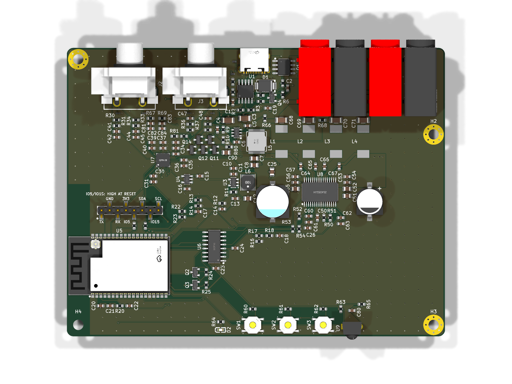
*The board as built, rendered from the KiCad file*

| Measurement | Result |
|---|---|
| PD voltage | Holds 20 V; VBUS 19.49–20.24 V across boards |
| PD contract current | 1.5–5.0 A, depends on the charger |
| Amplifier faults | 0 |
| Wi-Fi RSSI | -51 to -44 dBm |
| Lite 3 soak | 7.7 h, ended when the USB-C plug shifted and cut power |

### What we would change next spin

These are collected from the design review, the multi-board reviews, the simulations, and the bring-up and power-loss work.

**Power input**
- A stronger or locking USB-C connector with strain relief. The Lite 3 soak ended on a plug that moved.
- 100 to 220 µF, 35 V bulk at the buck input, behind an ideal diode or soft start so it does not break the USB-C attach limit. 220 µF holds about 40 mJ, about 12 ms of hold-up; the ~15 µF on the board today gives 1 to 3 ms.
- A brownout-aware SDZ mute for the amplifier.
- An open-drain 4.0 V detector in place of Q12 in the mute circuit, to remove its temperature drift.

**Amplifier**
- 1 µF PVDD capacitors right at the U8 pins with ground straight to the exposed pad, taking the loop to 2.8 nH or less.
- A PLIMIT divider so the amplifier itself limits power, not only the firmware.
- Output track necks only at the pins.

**Layout**
- Move the CH340 next to J1, or route USB on F.Cu, so the ground plane under the bucks has no slit.
- Return the amplifier input capacitors' ground to the codec, and route the amplifier inputs away from L5 and L6.
- Banana sockets at 13 mm within a pair and 15 mm between pairs.

**Protection**
- A TVS at J3 (PESD5V0S2BT) and a USBLC6-2SC6 on USB D+/D-.

**Bench work before the spin**
- Scope VBUS, PVDD and 3V3 during a plug wiggle, to see what the board sees when power is lost.

## 3. Firmware and app

Lite is the cheapest of the three receiver tiers. Its brain is an
ESP32-WROVER-E module: a dual-core ESP32 with 8 MB of PSRAM (4 MB of it
mapped) and 8 MB of flash, driving an ES8388 codec and a TPA3118 class-D amp from a USB-C PD
supply. This chapter covers the software on that module: where it came from,
what was added, how it streams from five kinds of source, how it updates
itself without bricking, how it was made smaller and harder to attack, how
several boards play in sync with no server, how it is tested, and the web
app the board serves to phones.

AI agents did all the work: design agents wrote the code and ran the bench,
and separate review agents read every change. The firmware docs are in
`docs/firmware.md`, `docs/test-api.md` and `docs/remote.md`. The lab notes
behind the security, test, party and handover work are in `docs/lab/`.

### Why squeezelite-esp32

The product brief asked for Spotify Connect, AirPlay, Bluetooth and
Lyrion/LMS on one cheap module. The open-source project
[squeezelite-esp32](https://github.com/sle118/squeezelite-esp32) already
does all of these on exactly this module. It ships cspot for Spotify
Connect, AirPlay 1, the Bluetooth A2DP sink and LMS with multi-room sync,
plus buttons, IR, OTA and Wi-Fi setup. It also already supports the ES8388
codec Lite uses. Writing a new streaming stack would have taken months, and
it would still have had to match a decade of LMS and AirPlay quirks. So the
design agents chose squeezelite as the streaming core and put their own work
next to it.

They had two ways to carry changes:

- **Fork the tree.** Simple at first, but after a few months nobody can say
  what was changed, and taking upstream's fixes becomes a merge project.
- **Pin a commit and keep a patch series.** Every change is a named file
  with a header that says what it does and why. Moving to a newer upstream
  is one edit to `firmware/upstream.lock`, followed by rebasing the patches.

They chose the patch series. Upstream is pinned in `firmware/upstream.lock`
at the master-v4.3 branch, commit `ee1720c`, on ESP-IDF v4.4.8. That IDF
line has been out of support since July 2024, and this is one of the
chapter's main open risks (see Security).

Everything that belongs to Lite lives in one component,
`firmware/components/hifi`. It is split in two:

- `core/` is plain C with no ESP-IDF in it: the power sequencer, the
  governor, the API, the volume, IR learning, party sync, source handover,
  OTA checks and so on. It builds and runs on a PC against a mock board
  (`make -C firmware/test`).
- `esp/` is thin. It reads pins, I2C and the ADC, drives GPIOs and calls
  into squeezelite.

Because the logic can run on a PC, almost all of it is covered by host tests
before it ever reaches a board.

#### How it is built

`firmware/tools/fetch.sh` clones upstream at the locked commit, checks out
the pinned IDF, applies `firmware/patches/*.patch` in order, applies the
IDF fixes in `firmware/idf-patches/`, and links in the `hifi` component.
`firmware/tools/build.sh` runs fetch, then `idf.py reconfigure` and
`ninja -j4` at nice 19, so a build on the shared build machine doesn't starve
other work. The build stamps itself with `HIFI_FW_BUILD`, the epoch time at
build, compiled into the image as the string `HIFI-BUILD:<n>;`. OTA uses that
number to refuse downgrades.

The build also enforces one security rule. If the link map names `upnp`,
`natpmp`, `ssdp` or `pcp`, the build fails. The board must never ask a home
router to open a port, and a library that slips in through a dependency is
caught at link time instead of in review.

`firmware/fw.json` describes the targets: the two images, the QEMU machine
(4 MB of PSRAM, 8 MB of flash) and the six QEMU fault scenarios used in
testing.

The build makes two images:

| Image | Slot | Slot size | Fill |
|---|---|---|---|
| `recovery.bin` | factory | 1.75 MB | 92% |
| `squeezelite.bin` | ota_0 / ota_1 | 3.06 MB each | 94% |

Both slots are nearly full, and that shaped several patches (below). One
practical gotcha: the Spotify client id has to be set at build time.
Without it the board shows up in the Spotify app, but tracks never start.

### The patch series

Each patch in `firmware/patches/` starts with a header saying what it
changes and why. There are 36 of them. Grouped by theme:

| Theme | Patches | What they do |
|---|---|---|
| Hooks | 0001, 0009, 0011, 0022 | The one place `hifi` reaches into squeezelite: a board choice in Kconfig, a boot hook, a DSP hook on every output block, a test-signal sink, HTTP route registration, and hooks on volume, the now-playing display calls, IR codes and button actions. |
| Robustness | 0002, 0003, 0004, 0008, 0030 | Fixes to upstream's error paths and restarts found during bring-up and fault testing. |
| UX | 0005, 0006, 0007 | Behaviour a buyer notices. For example, an idle Bluetooth phone is let go after 120 s so another phone or source can take over. |
| Security | 0010, 0012-0016, 0021, 0023, 0025, 0026, 0028, 0029 | The LAN gate, with telnet compiled out (0010). Recovery boots the last good app slot (0013). AirPlay input checks (0014), ogg/opus (0015), parser depth limits of 16 for cJSON and 10 for nanopb (0016), ALAC (0021), the Spotify TLS check against IDF's certificate bundle (0023), the signature on the Spotify access point's key exchange (0025), the Spotify LoginBlob race (0028), and libmad built from fixed source (0029). |
| Memory | 0019, 0020 | The decode and stream task stacks move to PSRAM, which gives back about 19 KB of internal RAM (0019). Sinks start once instead of on every Wi-Fi connect, which fixes the reconnect leak (0020). |
| Party mode | 0031-0033 | The hooks party mode needs in squeezelite's output path. |
| Source handover | 0034 | The arbiter's hooks into each sink. |
| App-only linking | 0017, 0018, 0027, 0035, 0036 | Keep the large app-only code (Spotify, AirPlay, party, the web app) out of the recovery image. The recovery slot had overflowed once. |

The hook patch was kept small on purpose. It only adds calls out to `hifi_*`
functions, and the logic stays in the component. That keeps the cost of
moving to a newer upstream low.

#### The IDF patches

IDF 4.4 gets no more security fixes, so the design agents backported them
by hand in `firmware/idf-patches/`.

- **Round 1** covered the three remote-reachable areas first: Bluedroid
  (Bluetooth), lwIP's DHCP server and mDNS.
- **Round 2** added 26 files: about 30 Bluedroid fixes, 9 lwIP fixes, the
  mbedTLS fix for the missing CA-bit check, a certificate bundle without the
  distrusted emSign roots, Wi-Fi SAE fixes, and netif fixes.

Five separate review passes by review agents read the backports. None found
a High.

Some fixes were held or skipped on purpose: the lwIP SYN_RCVD change, the
PTK-without-PMK Wi-Fi change (whether it can be reached in the closed Wi-Fi
library is unverified), nvs, and httpd. Upstream IDF drops the Comodo AAA
root from its bundle, but Lite keeps it: a server that sends AAA as the top
of its chain would otherwise fail to connect. The reasons are listed in
`docs/lab/cve-survey.md` and `docs/lab/security.md`.

### The hifi component

#### Power path and sequencer

Lite runs from USB-C PD. A CH224A sink chip negotiates the contract; a
resistor asks for 20 V. The firmware only reads the chip. Its status
register gives the negotiated protocol, and its current register gives the
contract's maximum current in 50 mA steps. VBUS from the ADC (a ÷11 divider)
is snapped to the nearest fixed PD level to give the voltage. The CH224A
cannot list the source's full capabilities, and its voltage register is
write-only. The firmware never writes it.

The sequencer (`core/hifi_power.c`) has these states:

| State | PVDD | Amp | Leaves when |
|---|---|---|---|
| `wait_pd` | off | off | The chip reports a good contract and VBUS has sat in 14-25 V for 200 ms. |
| `soft_start` | on | off | PVDD reads at least 85% of VBUS 400 ms later. If it is still down after 1 s, it goes to `no_pvdd`. |
| `on` | on | on with audio | The contract drops, VBUS < 13 V (under-voltage), > 25 V (over-voltage), or PVDD sags. |
| `undervolt` / `overvolt` | off | off | VBUS is back in the window for 1 s. |
| `no_pvdd` | off | off | Retries after 1 s. The third time in a minute latches. |

The start window is 14-25 V and the run floor is 13 V. The gap is there so
that a 15 V contract that sags under load and cable drop doesn't cycle the
amp, while a 12 V contract (12.6 V at most) is still kept out. **9 V and
12 V contracts leave the amp off.** The board's PVDD switch gets about 0.31
of VBUS as gate drive. At 9 V that is 2.2-2.3 V, which won't turn on a
P-FET whose threshold can be as high as 2.5 V. A laptop's 5 V port never
gets a good contract at all, and the hardware also ANDs the contract signal
with the switch enable.

PVDD is confirmed, not assumed. A second ÷11 divider reads it after the
switch. The amp leaves shutdown only once the switch is seen closed. A
switch that never closes, or one that sags while playing (a half-on FET
that is burning), shows up as `no_pvdd` instead of as a silent amp.

Amp faults (FAULTZ low after 50 ms of blanking) hold the amp off for 1 s and
then retry. Three faults inside a minute latch it off until a re-plug or an
API reset. After 10 minutes of digital silence the amp goes into shutdown,
with PVDD left up, and the first non-silent block wakes it.

#### The quiet stop

No planned restart or update may put a pop on the speakers.
`hifi_quiet_stop()` ramps the codec outputs down over 200 ms in 10 steps,
soft-mutes the DAC and waits 25 ms, then pulls the amp's SDZ low and waits
30 ms. Only then does the restart or update go ahead. The link wraps
`esp_restart`, so every restart runs it, including IDF's own rollback call.
The OTA writer calls it before erasing a slot, because the erase stalls the
audio. A failed or aborted update releases it and the sound comes back.
At boot the amp stays off until the codec answers, the routing is set, and
2.5 s more have passed. The recovery app never turns the amp on.

A panic, a watchdog reset or a brown-out can't run the quiet stop. In those
cases a pull-down drops SDZ at reset. `firmware/test/test_quiet_paths.py` scans the
source to check that every restart and update path calls the stop.

#### The power governor

A 65 W charger cuts its output if the box draws more than the contract
offers, and you hear that as a dropout. Two Lite channels at full sine into
4 Ω would draw about 94 W. The governor (`core/hifi_gov.c`) keeps the
average input power under 90% of the contract.

On every output block, after volume, EQ and loudness (the last step before
I2S), it measures each channel's mean square. It turns that into speaker
power through the analog chain, then into input power (speaker power /
0.88 + about 2.5 W for the rest of the board). If that would pass the
budget, it applies just enough gain reduction to sit on the budget. The
order matters: the EQ allows +12 dB a band, and a governor that measured
before the EQ would see a sixteenth of the bass power the amp actually gets.

The newest numbers in the code are:

| Setting | Value |
|---|---|
| Full-scale output (0 dBFS sine) | 18.2 V peak |
| Averaging time constant | 50 ms |
| Attack | 10 ms |
| Release | 2 s |
| Deepest cut | −26 dB |
| Budget | 90% of the contract |
| Thermal limit | 18 W over 30 s |

`docs/firmware.md` is older than the code here. It gives a 1 s average and a
50 ms attack. This chapter follows the code. On a 65 W charger, a 0 dBFS sine
on both channels is held at about −2.1 dB. Music averages about an eighth of
its peaks and never reaches the limit. The host tests check both cases.

DJ direct, the analog bypass from the line input to the amp, is invisible to
the governor because it never passes through the DSP. On Lite, the codec's
output cap and the input attenuator limit it. A DJ deck at full level into
4 Ω could still trip a 65 W charger, and the docs say so.

#### Heat cap and Boost

The TPA3118 on Lite has no heatsink and no over-temperature warning pin. It
cools into the board and the vented box. The governor therefore keeps a
thermal model as well as the supply budget, and `POST /api/v1/loudness`
exposes two settings:

- **`heat_cap_w`**: the sustained watts per channel the governor allows.
  The default is 9 W and the maximum is 15 W. Above 15 W the model reaches
  the amp's 150 °C shutdown, so going higher needs a fan, a heatsink and a
  measurement. Because there is no warning pin, a thermal trip looks like any
  other fault. A trip is forgiven only when the cap is above 9 W, the amp
  has been on at least 5 s, the heat estimate is above the default, and no
  other trip was forgiven recently. A forgiven trip lowers the cap by 2 W
  (saved), holds the gain 3 dB down for 60 s and keeps the amp off for
  15 s. Any other trip counts toward the 3-trip latch as usual.
- **`boost_db`**: 0 to 9 dB of digital gain before the governor, with a
  lookahead peak limiter (1 ms lookahead, 48 frames at 48 kHz) so a loud
  master gets louder without hard clipping. The ceiling is the amp's clip
  point from the lower of the contract voltage and the measured PVDD.
  Turning Boost on crossfades into the 48-frame delay over 4 ms, with no
  gap.

#### Channel mode and stereo pairs

Lite can play stereo, left only, right only or mono. A Lite can also be one
half of a stereo pair. The obvious place to do this was the ES8388's own
cross-mix registers. On the bench they did nothing, so channel mode runs in
the DSP, after the governor (`core/hifi_chan.c`). Mono is the sum of the two
channels at −6 dB, so a fully correlated signal doesn't clip. For a stereo
pair, each Lite is set to play one side, left or right. In the app this is
the Speaker output card.

#### Tones and self-test

`POST /api/v1/tone` plays a sine, a log sweep, pink noise or silence at
48 kHz. The tones enter squeezelite's output buffer the same way the
Bluetooth sink does, so they go through the same path, governor and codec as
music. Tones are capped at −6 dBFS unless forced. At most 100 ms is queued,
so a stop is prompt and ends with a 10 ms fade.

The self-test closes a loop in hardware. Each speaker output feeds back into
the codec's spare ADC input (LIN2/RIN2) through a 100k/10k divider (÷11)
with a 470 pF cap. That costs about $0.04 a unit. The self-test plays a tone
at −20 dB and checks that each channel comes back within ±3 dB. It also
checks the power state, the codec and free heap: at least 12000 B for the
self-test itself, and at least 16000 B at boot. A pass is what marks a new
firmware image good (see OTA).

#### Volume, now playing, IR and buttons

- **One volume** (`core/hifi_vol.c`). Every source sets squeezelite's output
  gain through one function. The patch hands that gain to `hifi` first,
  which applies the user's maximum and mute. The volume and maximum are saved
  to flash once they have been still for 3 s, so a turning knob doesn't wear
  the flash. At boot the saved volume is applied unless a source sets its
  own.
- **Now playing** (`core/hifi_meta.c`). The AirPlay, Bluetooth and Spotify
  sinks already call squeezelite's display functions with artist, album,
  title and timing. The patch passes those calls to `hifi` before the "no
  display" early return, so Lite gets them with no screen. Text is cut at a
  whole UTF-8 character. LMS draws its now-playing as graphics, so for LMS
  the app shows only "playing".
- **IR** (`core/hifi_ir.c`). `hifi` sees each decoded NEC frame first. While
  learning, a frame binds to an action. A learned code runs its action.
  Repeats closer than 250 ms count as a held button. Any other code goes on
  to squeezelite.
- **Buttons.** vol+ and vol− step the receiver's own volume when nothing
  streams. The play button works like a headphone button: 1 tap for
  play/pause, 2 for next, 3 for previous, and a 1 s hold for Bluetooth
  pairing.

#### Line in and DJ direct

Lite has no digital line-in path, because its codec's ADC is used for the
loopback taps. The API says so: `info.caps.line_modes` lists only
`dj_direct`, and asking a Lite for `line` gets a 409. DJ direct routes the
analog input straight into the codec's output mixers and takes the DAC out of
the mix. The volume then moves to the codec's analog output gain. The
speaker outputs are capped below 0 dB because 0 dB overdrives the amp.
`docs/firmware.md` gives this cap as −4.5 dB in one place and "−3 dB" in
another. Both point to the same board-review finding.

#### Diagnostics

`core/hifi_diag.c` and the `/api/v1/state` endpoint report the power state,
the contract, the supply voltage, the governor's gain and heat estimate,
faults, free heap, restart causes and the source. The firmware also counts
unplanned power cuts. The app's notices and graphs, the bench tests and
remote bring-up all read these.

### Audio sources and how they hand over

Lite plays from five kinds of source:

| Source | From | Notes |
|---|---|---|
| Spotify Connect | cspot in squeezelite | Needs the client id at build time. |
| AirPlay 1 | squeezelite's raop | Inputs bounds-checked (patches 0014, 0021). |
| Bluetooth A2DP | Bluedroid sink | About 6.6 KB of internal heap while on. |
| LMS / Lyrion | squeezelite proper | Has its own multi-room sync. |
| Line in | DJ direct, analog | Not a digital source on Lite. |

Upstream already lets a new source take over, but each sink did it in its
own way. A Bluetooth phone could hold the output after its user stopped
playing, and a takeover could start with a burst of the old stream. The
handover work (`core/hifi_source.c`, patch 0034, notes in
`docs/lab/source-handoff.md`) puts one arbiter in charge:

- **The newest source wins** (`hifi_source_decide`). The old source fades out
  over 200 ms in 10 steps before the new one starts.
- **Bluetooth lets go politely.** The board sends the phone a pause, then
  drops the A2DP link 1 s later, so the phone's player doesn't fight back.
- **A phone takes over only when it plays.** A Bluetooth connect by itself
  doesn't steal the output. The phone takes over when it reports playing, or
  1 s after it starts streaming, and in any case within 5 s.
- An idle Bluetooth phone is released after 120 s (patch 0007).

Results on the merged code, with a scripted Spotify-like client and a
Bluetooth test source:

| Measure | Result |
|---|---|
| Spotify takes over from Bluetooth | 10/10 |
| Start call | 201-241 ms |
| Login to audio | 221-253 ms |
| Bluetooth back after Spotify stops | 945-3024 ms, median 2.1 s |
| Free heap during the runs | 34-35 KB |
| Connect failures | 1 in 23 |

These runs did not use the real Spotify app with cspot, AirPlay, or a real
phone. They are listed under Open questions.

### OTA, signing, trial boot and recovery

#### Partitions

The flash holds a factory recovery app and two app slots. The normal app
runs from one slot while the other takes the update. The recovery app is
small and can only join Wi-Fi and take an update. It never turns on the amp.

#### Signed images

`firmware/tools/sign_fw.py` appends an 80-byte trailer to the image:

```
"HIFISIG2" | build number (8 B, little-endian) | Ed25519 signature
signature over:  "hifi-fw-v2:" + build + ":" + sha256hex(image)
```

The board checks the trailer before it switches slots. Putting the build
number inside the signed message means an attacker can't relabel an old
signed image as new. Updates from the LAN must be signed, and a lower build
than the running one is refused. Older v1 trailers are refused.
Updates through the board's outbound TLS dial-in (below)
are already authenticated per command, so the trailer is needed only on the
LAN path.

#### Trial boot and rollback

A new image boots in trial mode. It has 120 s to pass the self-test. A pass
marks the image good (`ota_valid`). A fail, or no answer in time, restarts
into the old slot (`rolled_back`). If the new image crashes before it can
decide, the bootloader rolls it back by itself. If both app slots are bad,
the board falls back to the recovery app, which (patch 0013) first tries
the last slot known to be good.

#### Remote bring-up over Wi-Fi

The design agents worked on the boards remotely, and the boards sat on an
ordinary home network that allows no inbound connections. So each board
opens an outbound TLS connection to a command service and waits for work
(`docs/remote.md`, `core/hifi_remote.c`):

- Every command is Ed25519-signed, names the board's id, carries an id
  higher than the last one, and must have a timestamp within 600 s of the
  board's clock. A replayed or redirected command is refused.
- If the connection drops, the board retries with back-off from 5 s to
  5 min.
- An OTA over this link is `begin`, then 4 KB chunks, then `finish` with the
  image's SHA-256.
- Tones played without anyone listening are capped at −30 dBFS.

Two speed-ups came out of bench work:

| Path | Before | After | Change |
|---|---|---|---|
| OTA of a 3 MB image over the dial-in | 152.8 s | 71.2 s | 3 chunks in flight instead of 1 |
| Update from a URL | 39 KB/s | 76 KB/s | Two buffers, so download and flash write overlap (PR #254) |

A board with no app running comes up fast. The app is up 1.3 s after reset,
has an IP at about 4.7 s, and is on the dial-in at 9-10 s.

### Memory work

The ESP32's internal RAM is small, and Wi-Fi, Bluetooth, TLS and the
decoders all want it. PSRAM is large but slower, and some things (DMA,
some driver paths) can't use it. Lite runs Spotify, AirPlay, Bluetooth and
a web server at once, so internal heap was the tightest resource in the
project.

The steps:

1. **Stack trims (PR #206).** Four task stacks were trimmed to measured use
   plus margin, and Wi-Fi TX buffers were set to 6. Free heap at boot went
   from about 12-14 KB to 20.5 KB. The smallest stack margin left is about
   1150 B, against a bar of 768 B.
2. **The reconnect leak.** A Wi-Fi drop test showed about 730 B of internal
   heap lost per drop. The cause was that the Spotify player and the AirPlay
   listener were created again on every Wi-Fi connect, and the old ones were
   never fully freed. Patch 0020 starts each sink once and lets it ride
   through reconnects. Over 30 drops, heap moved by −100 B and −112 B on the
   two test runs. The test plan fails at −200 B.
3. **PSRAM stacks (patch 0019, PR #232).** The decode and stream tasks don't
   need internal RAM for their stacks, so they moved to PSRAM. Idle heap
   went from 19.9 KB to 39.1 KB.

With Bluetooth on, A2DP takes about 6.6 KB. On Lite 1, the combined update
showed 39643 B free at boot. The older image, which did not yet carry all of
the new features, showed 46287 B. Both are well above the 16000 B boot floor.

### Security hardening

The security work is written up in `docs/lab/security.md` and
`docs/lab/cve-survey.md`.

#### Threat model

- **The LAN may play and adjust.** Anyone on the home network can stream to
  the board and change volume or EQ, as with any network speaker.
- **The LAN may not make things stick, leak secrets or redirect the board.**
  It can't change the remote-access settings, flash firmware without a valid
  signature, run console commands, or read secrets.
- **Browsers are hostile.** A web page on a phone in the house can send
  requests to the board (CSRF), and DNS rebinding can make it look like the
  same origin.
- **Nothing inbound from the internet.** The board makes no router port
  openings and needs none.
- **Physical access is out of scope** for this tier. Someone with a USB cable
  can reflash it.

#### The LAN gate (patch 0010)

Every HTTP request is checked:

- The `Host` must be an IP address, the board's own name, or a name under
  `.local`, `.home.arpa` or `.internal`. That defeats DNS rebinding, because
  a rebound attacker domain arrives with the attacker's name in `Host`.
- For state-changing calls, the `Origin` must match the host. That defeats
  CSRF from other web pages.
- Upstream's `Access-Control-Allow-Origin: *` was removed.
- `config.json` is served with secrets redacted.
- Telnet is compiled out.

The Wi-Fi setup access point comes up only after 10 minutes without a
saved network connecting. Once Wi-Fi has been saved, the access point uses a
random 12-character password instead of upstream's fixed one.

#### Listening sockets

The firmware has an allow list of listening ports, and a test checks it:

| Protocol | Ports | Why |
|---|---|---|
| TCP | 80 | Web app and API |
| TCP | 5000 | AirPlay |
| UDP | 5353 | mDNS discovery |
| UDP | 68 | DHCP client |
| UDP | 67, 53 | Only while the setup access point is up |

There is no SSDP, no LLMNR and no UPnP, and the build fails if UPnP code is
linked. A full LAN port scan of three boards passed. Each scan took about
262 s, and 65533 TCP ports were closed on each board.

#### Fixes to upstream

The CVE survey read each upstream library for known bugs and fuzzed the
parsers (see Tests). The four Medium findings were fixed:

| Area | Problem | Fix |
|---|---|---|
| ALAC (AirPlay) | A crafted 300-byte packet panicked the board | Bounds checks (patch 0021). The crafted packet is now refused 64 times out of 64. |
| Spotify TLS | cspot's own TLS connections were not checked against a trusted bundle | Every connection checked against IDF's certificate bundle (patch 0023) |
| Spotify LoginBlob | A race in the zeroconf login | Locked (patch 0028) |
| libmad (MP3) | Old prebuilt library with known bugs | Built from fixed source (patch 0029) |

Smaller fixes include ogg/opus bounds (0015) and nesting limits for cJSON
(16) and nanopb (10) (0016).

Three Lows are still open:

- Spotify TLS doesn't check certificate expiry (mbedTLS time checks are off),
  so an expired certificate from a trusted CA is still accepted. The fix is
  to turn the check on once network time is known to be set.
- cspot has some unchecked NULLs.
- The recovery app accepts unsigned images over USB. That is consistent
  with the physical-access scope.

Two bigger items are planned but not done. Secure boot and flash encryption
are not burned into the eFuses on any board yet; the plan is to do that at
the factory step. A port to IDF 5.5 is planned, but not started.

### Party mode

Upstream's multi-room sync needs an LMS server on the network. Most buyers
won't have one, so party mode (`core/hifi_party*.c`, patches 0031-0033,
`docs/lab/party-mode.md`) syncs Lites with no server at all.

#### How it works

- **One leader.** Whatever is playing on the leader (Spotify, AirPlay,
  Bluetooth) is tapped after the volume stage. The PCM is sent to each
  follower by UDP unicast with a 300 ms delay, which covers Wi-Fi jitter and
  retries.
- **The clock is Wi-Fi's own.** Every station on an access point keeps the
  access point's TSF timer, a 1 µs counter that the Wi-Fi hardware already
  keeps in step. Leader and followers stamp and schedule audio against it.
  No extra time protocol is needed.
- **Followers track by frames.** A follower drops or repeats one frame per
  46 ms block, as needed, to stay on the leader's schedule.
- **Discovery and control.** The leader announces every 1 s, followers join
  every 1 s, and clock messages go every 200 ms. A peer that is silent for
  3 s is dropped. Messages are signed with HMAC keys derived from a household
  secret, so a stranger on the LAN can't join or inject audio.
- **Limits.** Up to 3 followers, each costing about 10% of the airtime.
  Bluetooth is off on followers to keep the radio for Wi-Fi.

#### Measured

| Measure | Result |
|---|---|
| Follower offset (self-referenced, TSF stamps) | ±23 µs, p95 about 21 µs |
| Clock drift between boards | 5.7 ppm |
| Leader playing A2DP: blocks concealed | 4% before the fix |
| After PR #245 (send deadline, AMPDU TX) | 0.6%, against 43% on a control run |

The offset numbers are self-referenced: the boards measure themselves
against the same TSF they sync to. A check by an independent method, such as
a cable between two boards' outputs or a microphone, has not been done yet.

The A2DP case is the hard one. When the leader also receives Bluetooth, its
one radio is shared, and below about 125 packets per second the target is
not met. A second round of work on this is open.

### Tests

The test stack has five layers. The numbers below are from
`docs/lab/hifi-lite-tests.md`.

#### Host tests

`make -C firmware/test` builds `core/` against a mock board and runs the C
tests plus a few Python checks, such as the quiet-stop path scan and the
port allow list. Coverage of `core/`:

| Measure | Coverage |
|---|---|
| Lines | 99.0% |
| Branches | 83.9% |
| Functions | 204/204 |

There are also regression tests for upstream bugs. Each one is written so
that it fails on pristine upstream and passes with the patch. That proves
the patch is what fixed it.

#### Fuzzers

Five libFuzzer harnesses (`firmware/test/fuzz/`) cover the API, the
console commands, the JSON parser, the remote commands and the WebSocket
frames. Two more cover ESP-NOW and BLE input. Each ran for 10 minutes, at 44 million to 489
million runs per harness, with no crash at the end. Along the way they found
and drove fixes for size casts and NaN handling.

#### QEMU

The app boots in QEMU (ESP32 with 4 MB of PSRAM and 8 MB of flash) under six
fault scenarios from `fw.json`:

| Scenario | What is injected |
|---|---|
| `selftest` | The self-test with the PD sink at 20 V. What QEMU can stand in for passes; the I2C parts fail and say so. |
| `brownout` | VBUS and PVDD sag to about 12 V with the amp on. The sequencer leaves `on` and comes back once the supply has been good for 1 s. |
| `pd_loss` | The contract drops and VBUS falls to 5 V. The sequencer waits on PD with PVDD off, then powers up again. |
| `i2s_stall` | The audio output never drains. A tone must still be taken, and the API and controls must still answer. |
| `full_flash` | The settings partition is full at boot. The board must come up, and saving must fail without a crash. |
| `heap_squeeze` | Internal RAM squeezed to 10 KB free. The self-test's heap check fails and says so, and the API still answers. |

#### Hardware in the loop

`fw hil` runs a suite against a real board on the bench through the test API
(`docs/test-api.md`). On Lite 5 it passed 32 of 32. It runs nightly at
08:00 UTC, together with the Wi-Fi drop plan used to find the reconnect leak.

Audio was measured through the loopback taps on Lites 2-4:

| Measure | Result |
|---|---|
| Frequency response | within ±1.5 dB (−0.61 to +1.13 dB) |
| THD+N at −20 dBFS | 1.1-1.8% (mono ≤ 3.14%) |
| Noise | 2-4.5 mV |

The taps are a 1/11 divider into the codec's ADC, so these numbers include
the ADC's own distortion and noise. They show that the chain works and
matches across boards. They are not a hi-fi specification.

#### App and user paths

The app's own suite drives the real board through the API, and it passed
45/45. A "user path" suite on Lite 2 walks through what a buyer does in the
app: 33/33, and 38/38 after more paths were
added. Two bugs found in testing were fixed: JSON escapes in track text
(PR #250) and strings cut in the middle (PR #255).

After a board rebooted when its USB-C plug shifted, a power-loss audit read
every flash write path (settings, OTA, the trial boot). A cut at any point
is safe: NVS writes are protected, and the boot slot changes only after the
new image has been checked. Host tests now cover supply glitches, and the
firmware counts unplanned power cuts.

### The web app

The board serves its own app. There is nothing to install from a store and
no cloud account. A phone on the same Wi-Fi opens the board's address, and
the app can be added to the home screen as a PWA.

#### Build and size

The app is plain JavaScript, HTML and CSS with no framework, in `app/web`.
`app/build.py` minifies and gzips it into the firmware image. It is about
45 KB gzipped, against a 64 KB budget set because the app slot is 94% full.
The board serves it with ETags, so a repeat visit gets 304s and loads from
the browser cache. Work on first paint brought it from 470 ms to 296 ms.

A service worker would let the app open offline, but browsers only allow
service workers on HTTPS or localhost, and the board serves plain HTTP on the
LAN. So there is no service worker. The app works fine without it.

#### Screens

| | | |
|---|---|---|
| 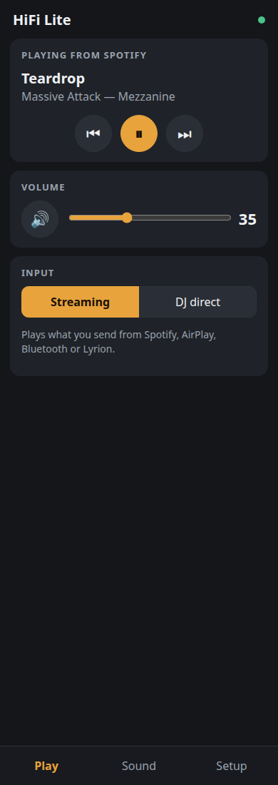 | 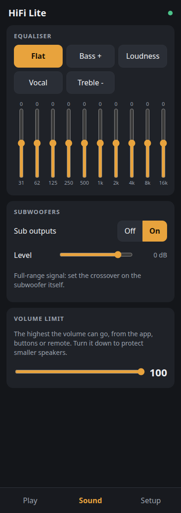 | 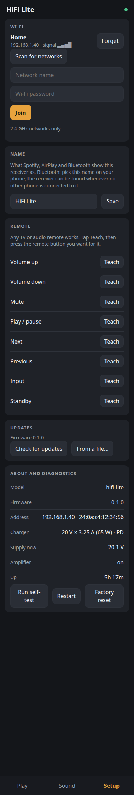 |
| Play | Sound | Setup |
| 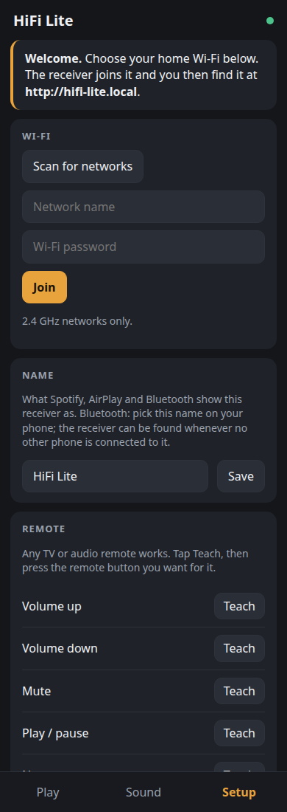 | 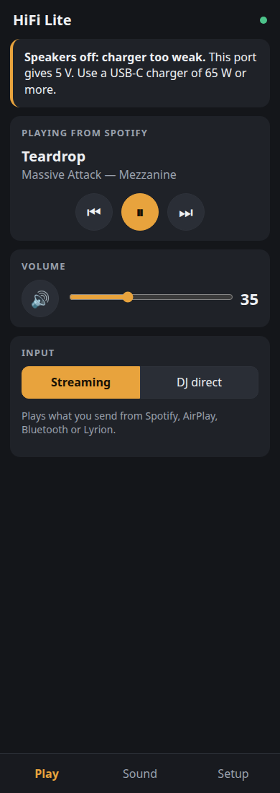 | 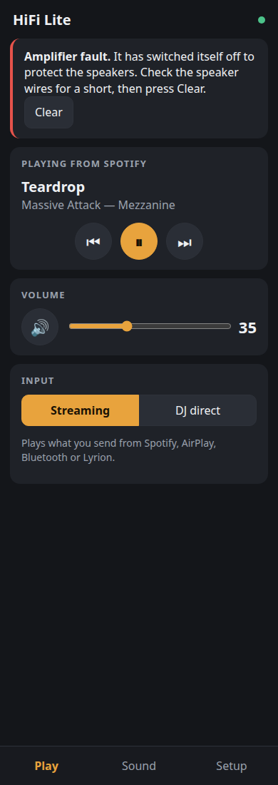 |
| First run | Weak charger | Amp fault |

The app has three tabs, plus notices and a first-run flow. It reads
`info.caps` from the board and shows only what this tier can do, so the same
app serves all three tiers.

| Screen | What it does | Screenshot |
|---|---|---|
| Play | Now playing (title, artist, album) with previous, play/pause and next; volume and mute; a Power card with watts in and out, the charger's contract, the governor's budget and a 5-minute graph ("Limiting." or "Supply sagging." when they apply); the input (Streaming or DJ direct); party mode on/off and who leads | `docs/app-screens/play.png` |
| Sound | A 10-band EQ (31 Hz to 16 kHz, ±12 dB, with presets); sub on/off and level; the volume limit; Loudness (Boost and heat cap) | `docs/app-screens/sound.png` |
| Setup | Wi-Fi (2.4 GHz only), name, IR remote teaching, updates (online or a `.bin` upload), and About and diagnostics: 15-minute graphs of power, supply, Wi-Fi signal and free memory, the self-test with each check in plain words, restart and factory reset | `docs/app-screens/setup.png` |
| First run | Join the home Wi-Fi from the board's own setup network. A join that hasn't landed after 45 s says to check the password and the band, and the setup network stays up. | `docs/app-screens/first-run.png` |
| Notice: weak charger | "Speakers off: charger too weak", for example on a 5 V port | `docs/app-screens/weak-charger.png` |
| Notice: fault | "Amplifier fault…", a latched fault, with a Clear button | `docs/app-screens/fault.png` |

There is no source picker. As with any Spotify Connect or AirPlay speaker, a
stream starts when a phone plays to the board, and the app shows what is
playing. The graphs need nothing from the firmware: the app keeps each state
poll (every 2 s) in memory and draws plain SVG. Factory reset asks the user
to unplug the board and plug it back in to finish, so a web page on the
network can't erase it alone.

The weak-charger notice comes straight from the power design. The most
likely first complaint is "it connects but makes no sound" from someone
using a weak charger, and the app says why.

#### Mock server and tests

`app/mock/server.py` implements the test API with a fake board. It can play
any of the three models, start in first-run mode, stand in for a laptop's
5 V port (amp off) or show a latched fault. That way the app can be built and
tested with no hardware. The tests in `app/tests/` (`test_app.py`,
`test_paths.py`, with `cdp.py` driving headless Chrome) check the API
contract on all three models, that every file the app references exists,
that the pack is under budget and byte-for-byte repeatable, and the Play
page, first run, Setup page and weak-charger notice in a browser. The same
suite then ran against real boards, as described under Tests.

`app/screenshots.py` renders the screenshots in `docs/app-screens/` from the mock,
so they always match the code.

## 4. Enclosure, bring-up, testing and lessons

This chapter covers the parts of the Hi-Fi Lite that came after the PCB was ordered: the printed box, the first power-up of the five assembled boards, the tests and measurements that followed, and what the project taught. The board is the 2-layer `lite-main` (ESP32 module, CH224A USB-C PD sink, ES8388 codec, TPA3118D2 class-D amplifier). Everything here was designed and run by AI design agents working from a shared repository. The owner held, plugged in and listened to the hardware.

### Enclosure

#### Approach: the box is generated from the board

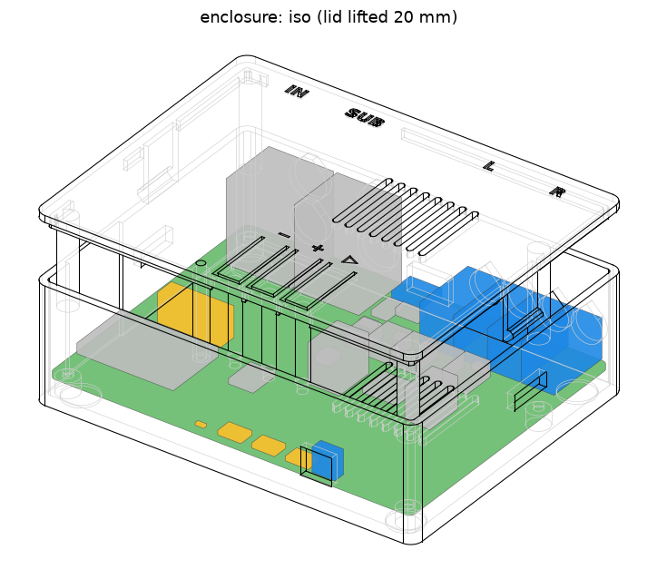
*The screwless snap box, rendered from the same code that makes the STL files*

The enclosure is Python CAD (build123d, driven through the `mech` tool from the hive-mech package). Nobody draws it. Two inputs define it:

- `lite-main.board.json` is read from the KiCad PCB by `mech board`. It holds the outline, mounting holes and every connector's position and facing edge.
- `heights.json` gives component heights that KiCad does not reliably know.

The scripts place port cutouts, standoffs, lid posts and keep-outs from those files. When the PCB changed, the box was rebuilt rather than edited. This paid off on 2026-11-06. PR #176 changed mounting hole H4 to a 3.2 mm NPTH, and the enclosure rebuild was byte-identical, so the box needed no work.

The 3D models were not fully trusted. The stacked RCA jack's model sat 13.5 mm too low and 6.1 mm too far into the board, compared with its datasheet. Its position is corrected by hand in the script. Without that, the RCA cutout would have landed in the wrong place on the rear wall. The lesson is the same one the PCB taught about library footprints: read every connector's data, and do not trust a pulled model.

There are two generations in `enclosure/`:

| Script | Fastening | Output | Status |
|---|---|---|---|
| `lite.py` | screws through the board's mounting holes | `enclosure/out/lite/` (STEP, STL, PNG, 7-page assembly PDF) | printed 2026-11-16; spring-tongue lid and labels added |
| `lite_snap.py` | screwless: pins through the mounting holes, wall hooks | `enclosure/out/lite-snap/` | v1 printed and failed to latch; v2 print not confirmed |

#### History

| Date | Change |
|---|---|
| 2026-10-28 | First enclosure commit, made alongside the first board layout |
| 2026-10-29 | Refit to the final `lite-main` outline |
| 2026-10-30 | Made printable without supports: RCA holes became teardrops, and a 22 mm bridge was removed |
| 2026-11-01 | Hole axes fixed during the pre-order review |
| 2026-11-05 | Antenna keep-out and Bambu A1 mini slicing added (PR #175) |
| 2026-11-06 | Rebuilt after PR #176's H4 change; byte-identical |
| 2026-11-16 | First print in PLA; first lid's loose buttons failed; spring-tongue lid; lid labels |
| 2026-11-17 | Screwless snap box v1 printed, did not latch; v2 designed and committed (e66f2d7) |

#### Key dimensions

| Item | Value | Why |
|---|---|---|
| Outside size | 124 × 96 × 39.8 mm | board plus walls and RCA headroom |
| Wall / floor / lid | 2.4 / 2.0 / 2.2 mm | stiff in PLA or PETG at 0.4 mm nozzle line widths |
| Board-to-wall gap | 0.6 mm | print tolerance plus board outline tolerance |
| Standoff height | 5 mm | the RCA jack's through-hole pins stick out 2.9 mm below the board |
| Headroom over the board | 29 mm | tallest part is the stacked RCA at 27 mm, plus 2 mm |
| RCA holes | 12 mm, teardrop top | print without support on a vertical wall |
| USB-C cutout | 13.4 × 7.6 mm | plug overmould clearance, not just the receptacle |
| IR window | 9 × 8 mm | receiver lens with margin |
| Banana posts | 10.2 mm, teardrop roof | as above |

#### Antenna keep-out

The ESP32 module's PCB antenna faces one wall. Plastic close to a trace antenna detunes it, and a thick wall right next to the antenna is the worst case. The script thins that wall to 1.2 mm over a window 2 mm wider than the module on each side. It also drops the lid's locating lip along that stretch.

The build fails if any other feature enters the keep-out zone, so a later edit cannot quietly put a post or a rib there. Detuning was not measured. The boards in the box joined Wi-Fi at the same RSSI range as bare boards in the self-test reports (−51 to −44 dBm), but nobody measured the same board in and out of the box.

#### Fit checks

`mech` runs automated fit checks on every build, and a build with a failed check is not shipped:

- every board part clears the walls, lid and posts;
- every port cutout lines up with its connector on the right face;
- every mounting hole is held by a standoff or pin;
- each part fits the printer bed (A1 mini, 180 × 180 mm);
- printability: overhang angle, unsupported bridge length, thin walls.

On 2026-11-05 the screw version passed 43 of 43 checks.

The checker had one bug of its own. When the snap box went to pins through the mounting holes, the checker counted each pin inside its hole as a clash. Pins are meant to sit in holes. That was fixed in hive-mech PR #56, not by loosening the box.

#### Printing on a Bambu A1 mini

The first slicing work (PR #175, 2026-11-05) targeted PETG:

| Part | Time | Filament |
|---|---|---|
| Base | 1 h 48 min | 63 g |
| Lid | 1 h 33 min | 31 g |

That work turned up a slicer bug. The generated PETG profile came out labelled as PLA with a 45 °C bed, because OrcaSlicer ignored settings inherited from the parent profile. The fix writes every material setting out in full.

On 2026-11-16 the printer had PLA Matte loaded, not PETG. The PETG job was cancelled at layer 0 and the base was re-sliced for PLA: 65 °C bed, 220 °C nozzle, about 92 minutes, 69 g.

#### Buttons: loose plungers failed, spring tongues worked

The board has tactile switches under the lid. The first lid (75 min, 34 g) had separate printed plungers that drop into guides over each switch. They failed. The plungers missed the switches and fell into the box. Loose parts in a guide need a tight fit, and a printed guide is not tight enough.

The replacement, `keys()` in the script, makes each button part of the lid:

| Feature | Value |
|---|---|
| Tongue width | 7 mm |
| Slot around it | 1 mm U-shaped cut |
| Root | 22 mm from the front edge |
| Arm thickness | 1 mm |
| Plunger | 4 mm diameter, 3 mm tip |
| Rest gap to switch | 0.4 mm |
| Travel to actuate | about 0.65 mm |
| Force | about 1.2 N (about 1.8 N/mm spring rate) |
| Lid print | 1 h 18 min, 34 g |

The tongue is a cantilever cut out of the lid top. The plunger hangs under its free end, 0.4 mm above the switch. A press bends the tongue about 0.65 mm. The gap keeps the switch from being held down by print tolerance, and the force is in the range of a normal tactile button.

The owner's verdict on the printed lid was "New lid works... Lid buttons work great."

#### Labels

Labels are debossed 0.5 mm into the lid top in DejaVu Sans Bold. They sit on the lid, not on the rear wall next to the jacks, for a printing reason. The lid prints face down, so lettering on its top surface is crisp and needs no support. Lettering cut into a vertical wall would need support inside each letter.

The first set named the connectors: AUX, SUB, 5V, L+ L− R+ R−. The owner asked for shorter labels: IN, SUB, L, R, plus − + ▶ next to the buttons. In this font the N leaves two slivers 0.2 mm wide, which the thin-wall check flags. So the labelled lid passes 30 of 31 checks, and that one failure is accepted as cosmetic. A second base was printed with tree supports.

A play button in the middle was discussed but not built.

This work lives on the `lite-spring-buttons` branch (PR #186, b3e0298), which had not been merged to main when this was written. Current files: base 1 h 47 min / 72 g, lid 1 h 23 min / 36 g.

#### The screwless snap box

The screw box needs four screws and a screwdriver. `lite_snap.py` aims for a box that closes by hand:

- Pins of 2.85 mm diameter rise from the floor through the board's 3.2 mm mounting holes, so the board locates without screws.
- Lid posts of 6 mm diameter come down and stop just above the board, holding it on its standoffs without clamping it. The post gap was 0.1 mm in v1 and became 0.3 mm in v2.
- Hooks hang from the lid on the west and east walls at y = 50 mm and catch in windows cut through the base walls.

**v1 did not latch.** The owner reported: "the latches didnt engage theyre too small and too short". The geometry explains it:

| | v1 | v2 (e66f2d7, 2026-11-17) |
|---|---|---|
| Hook arm | 1.4 × 14 mm | 1.6 × 18 mm |
| Catch depth | 1.0 mm | 1.8 mm |
| Play | 0.1 mm | 0.6 mm |
| Peak strain when flexed | — | about 1.3 % |

The nominal 1.0 mm catch was not what the hook actually got. The lid lip's gap took 0.25 mm, so the hook reached only 0.75 mm past the inside of the wall. With print tolerance on top of that, it barely caught. The 0.1 mm play meant any oversize in the hook or the window kept it from snapping in.

v2 makes the arm longer, so it bends more easily for the same deflection, and makes it thicker for strength. The catch is deeper. The play is enough to take printer tolerance. About 1.3 % strain is comfortably inside what PLA tolerates for repeated flexing.

**v2 is not confirmed.** Three base prints were tried:

1. The printer reported layer 188 of 188 and done, but the part was visibly incomplete. Running out of filament or a feed fault is suspected.
2. It stopped at layer 182 of 188 with no error.
3. The printer was offline, and the result is unknown.

Whether v2 latches is open.

#### Documentation debt

`enclosure/README.md` lags the work. It still says PETG (it calls PLA a fallback at about 55 °C bed), still describes the loose plungers, and says "Labels: none yet". The scripts and the commit history are the current truth.

### Bring-up

#### The plan

`docs/bringup.md` was written and reviewed before the order (PRs #162 and #163, merged 2026-11-04). It is a staged plan where each step limits the damage if the previous one hides a fault:

| Step | What | Pass criteria |
|---|---|---|
| 0 | Visual | orientation, bridges, missing parts |
| 1 | Unpowered resistance | rail to ground; PVDD about 18.3 kΩ (divider) |
| 2 | Bench supply, 5 V current-limited to 150 mA, then 12 V and 20 V | 5.18 V / 3.33 V / 3.30 V rails; PVDD must stay 0 V |
| 3 | Flash over the CH340B USB-serial bridge, run self-test | console up, I2C devices found |
| 4 | PD at 20 V (R1 = 120 kΩ sets the request) | soft start 80–160 ms, rise 25–40 ms, inrush 0.4–0.5 A |
| 5 | ES8388 codec | MCLK 12.288 MHz on GPIO0 |
| 6 | TPA3118D2 into 4 Ω BTL at 26 dB gain | clean output, no fault |
| 7 | Line in, subwoofer out, power-fail mute | |

Step 2 checks a deliberate interlock. PVDD, the amplifier supply, is switched on by firmware (PVDD_EN on GPIO18), but that signal is ANDed through Q4 with the CH224A's power-good output. A firmware bug cannot put the amplifier on an unnegotiated or wrong supply. On a plain 5 V or bench supply with no PD contract, PVDD must read 0 V whatever the firmware does.

The plan also records the numbers behind the PVDD path. There is 0.75 mF of bulk capacitance with a bleed time constant of about 15 s, so PVDD stays dangerous for a while after unplugging. D1 is an SMBJ22A clamp.

Step 9.4 flags a known compliance gap. The PD sink presents about 15 µF on VBUS (cSnkBulk), and the USB PD limit is 10 µF. Some chargers may object, so charger compatibility is an item to watch.

The committed plan was never updated with results. It still says no board has been built. The results below come from the project's working notes and test reports.

#### What actually happened

The five assembled boards arrived in mid-November. Before they came (2026-11-15), the design agents built a "plug in a board" web-serial page, so the owner could connect a board to a laptop and let the agents see its console without installing anything. All five boards were brought up on 2026-11-16.

**Lite 1 on laptop USB (5 V, no PD).** The first board exposed a chain of firmware problems. None was a hardware fault.

1. *It booted into recovery.* The board came up in squeezelite's RECOVERY image, not the main app. The published `ota_data` partition image was all 0xFF, so the bootloader had no valid app selection and fell back. The build now writes an `otadata` that points at `ota_0` and marks it valid. Recovery stays as the fallback.
2. *The main app did not build.* The WebSocket library was switched off in the configuration.
3. *Log flood.* About 690 lines of "i2c driver not installed" appeared in 8 seconds. The power-monitor task started polling the PD chip before the I2C driver was installed. Fixed by ordering the start-up.
4. *The console dropped input.* The console read one character per line read, so whole lines pasted from the web page were lost. Fixed in firmware patch 0003.

All four went into PR #185.

**First self-test on 5 V.** The PD chip, VBUS sense, codec and PSRAM passed. The PD contract, PVDD, amplifier fault line and network checks failed. That was expected with no charger and no Wi-Fi yet, and PVDD staying at 0 V confirmed the interlock.

One check failed for a real reason: free internal heap was 17.4 KB against a 20 KB floor. The tone and line-input tasks' stacks were moved to PSRAM, which brought it to 21.5 KB.

**Wi-Fi.** The board joined the network, and three more faults appeared:

- The board silently failed to start its outbound connection to the remote bench. It now starts reliably.
- The WebSocket library lost the first message after connecting. It was replaced with the project's own small client.
- Stock squeezelite restarts the board about 3 minutes after boot if it cannot find a Logitech Media Server. That suits a squeezelite-only player but not this product, which also plays Spotify and Bluetooth. The watchdog restart was removed.

**First sound.** Lite 1 then went onto a 20 V USB-C PD charger with one speaker. Every self-test check passed, including PD contract, PVDD and amplifier fault. The first sound was a 4-second 440 Hz tone, then left/right identification, a sweep and a short tune. The owner heard all of it. The other four boards were brought up the same day by the same procedure.

#### Faults found in the first two days

With five boards in use, more faults surfaced. All were firmware:

| Fault | Cause and fix |
|---|---|
| Renaming the speaker restarted it without saving the new name | Restart came before the settings write; reordered |
| Bluetooth pairing crashed the board (panic) | Reproduced board-to-board with no phone involved. A crash recorder and an `api crash N` command were added to read the last panics remotely. The Bluetooth stack failed to create a timer on connect; the timer pool was enlarged |
| A test build without the bench signing key locked Lite 2 out of Wi-Fi updates | One USB reflash recovered it. `build.sh` now always builds the key in (8e1f9a4) |
| Spotify skip was slow | Audio queue too deep; shortened |
| Spotify told other users the speaker was taken | Last user to pick the speaker now takes over |
| Bluetooth became invisible after one phone connected | An idle phone is released after 2 minutes; pairing needs no PIN |
| Next/previous with nothing playing froze the controls for minutes | Fixed 2026-11-17 |

Headphone-style button gestures were added in the same period.

Each board went through at least three Wi-Fi updates in this time and kept its settings every time.

The Wi-Fi update path is guarded in two ways. Every image sent over the air must carry the remote access path and the signing key. An image marks itself good only after its own self-test passes, and otherwise the bootloader rolls back. The Lite 2 lockout is the failure that rule exists to prevent. The build script now enforces it, not the person running the build.

### Testing and characterisation

#### The remote bench

The boards stay plugged into a bench computer by USB, and the design agents work them remotely. The `bench/` directory holds the tooling. In outline:

- A bench service holds each board's serial port, so several agents can read consoles and send commands without fighting over the port.
- Boards are leased. An agent takes a lease before flashing, so two agents cannot flash one board at the same time.
- A fleet command flashes several boards in parallel, runs the self-test on each, and collects the reports.
- Hardware-in-the-loop (HIL) runs drive a test suite against a board over its console and its Wi-Fi API (`fw hil`). Lite 5 runs it nightly.
- Wi-Fi updates go through the board's signed update path, so most work needs no USB at all.

After bring-up, all five boards became lab boards. They are used for firmware hardening, inter-board radio experiments (ESP-NOW, BLE) and test development, with one board per line of work where possible. Two rules held throughout. eFuses (secure boot, flash encryption, JTAG disable) are never burned, because that is irreversible. And nothing on a board may open ports on the home router (no UPnP or NAT-PMP, and no access point that routes).

#### Self-test reports

The firmware's `api diag` reports heap, PSRAM, task stack high-water marks, CPU load per task, Wi-Fi RSSI, boot and update times, I2S underruns and the PD rail readings. Reports are filed per board under `docs/lab/reports/`. The 2026-11-17 set covers all five boards:

| Metric | Result |
|---|---|
| Self-test | 5 of 5 pass |
| Free internal heap | 12.9–16.2 KB; minimum seen 10.3 KB |
| Tightest task stack | `hifi_relay`: 716 B free of 4 KB, raised to 5 KB (PR #192) |
| Busiest core | 18.1 % |
| Wi-Fi RSSI | −51 to −44 dBm |
| Boot to network link | 9.0–9.3 s |
| Wi-Fi update write | 19.5 s |
| Audio latency | 128–139 ms |
| PD contract | 20 V on all five |
| VBUS | 19.49–20.24 V |
| PVDD vs VBUS | up to 0.31 V above VBUS (within the ±0.3 V measurement tolerance) |
| Amplifier faults | 0 |

The heap figure is lower than the 21.5 KB reached at bring-up because more features went in after it. A later combined update on Lite 1 (2026-11-18) cut boot-time heap use from 46,287 B to 39,643 B.

#### Audio measurements

The board has no audio analyser attached. Instead, it measures itself. Each speaker output leg feeds a resistive divider into the ES8388's ADC (the loopback taps). `docs/lab/tools/audio_measure.py` plays test signals and analyses what comes back (PR #219). The method is described in `docs/lab/characterize.md`.

This measures the whole path: DAC, amplifier, divider and a 16-bit ADC. The ADC limits the noise and distortion figures, so they are not speaker-terminal figures from a real analyser. The leg scale (20.32 V per ADC full scale) comes from the divider values and has not been calibrated against a meter.

Pass criteria and results at the standard level, stereo, left/right:

| | Pass | Lite 2 | Lite 3 | Lite 4 |
|---|---|---|---|---|
| Frequency response (band) | ±1.5 dB | −0.49 to +0.95 dB | −0.41 to +1.13 dB | −0.61 to +1.05 dB |
| THD+N | ≤ 2.5 % (mono ≤ 5 %) | 1.45 / 1.08 % | 1.18 / 1.14 % | 1.12 / 1.20 % |
| Noise | ≤ 5 mV | 3.9 / 3.6 mV | 3.1 / 4.4 mV | 3.0 / 2.5 mV |
| Muted channel | ≤ 0.001 FS | 0.0004–0.0006 FS | | |

Mono output measured −6.0 dB relative to one channel. Lite 2 measured from 40 Hz to 16 kHz stayed within −0.13 to +0.55 dB. Lites 1 and 5 were not measured.

THD+N against level on Lite 2 (left / right):

| Level | THD+N |
|---|---|
| −30 dBFS | 3.5 / 4.0 % |
| −12 dBFS | 0.71 / 0.75 % |
| −6 dBFS | 0.47 / 0.41 % |

The figure falls as the level rises, which is the signature of noise, not distortion. Removing the harmonics from the residual leaves about half of it. These are measurement-path figures, mostly the 16-bit loopback ADC's noise floor, and not the amplifier's own THD+N.

Channel isolation was 48–50 dB at −6 dBFS and 33–35 dB at −20 dBFS. The self-test's crosstalk check reads −49 to −62 dB. The lower figure at low level is again the noise floor.

A review of the analysis code found that noise figures posted before the fix were 1.41 times too low. The table above uses the corrected figures.

**Loopback failed on the first self-test after a flash.** It passed on later runs. Several start-up races were behind it, fixed in PRs #253, #257 and #259:

- the amplifier now settles before the measurement starts;
- the ADC reference powers up first;
- the capture ring buffer is flushed;
- the first 100 ms of capture are dropped.

After the fix, 25 of 25 flash-then-test runs passed on Lites 2 and 3.

#### Soak test

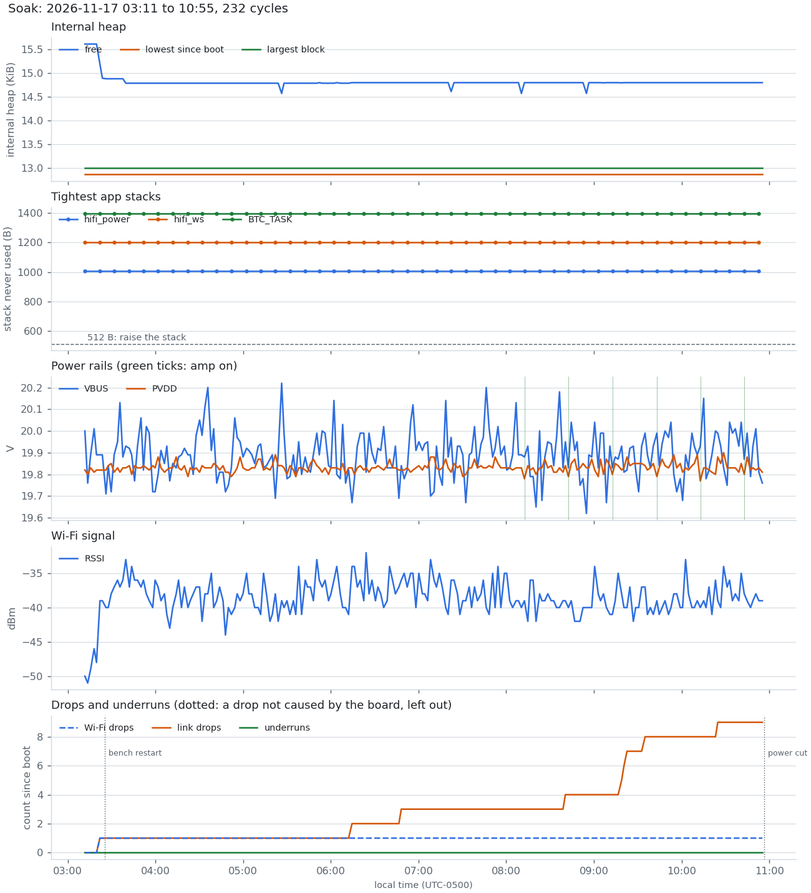
*Lite 3's soak: 7.7 hours of playback, ended by a USB-C plug that shifted*

Lite 3 started a 12-hour soak on 2026-11-17 at 03:11, playing repeated −20 dBFS test tones with diagnostics logged throughout. It ran 7.7 hours (232 cycles) before a power cut: the USB-C plug shifted in its socket. Up to the cut:

- 0 tone failures, 0 audio underruns, no restarts;
- one 736 B step in heap use at the run's single Wi-Fi drop, then flat.

The heap step led to a real leak: each Wi-Fi reconnect lost about 730 B. Firmware patch 0020 fixed it. A test of 30 forced drops now shows a net change of −112 B, which is noise.

The chart is `docs/lab/reports/lite3-soak-2026-11-17.png`. The full 12 hours has not been run since.

#### Power-loss safety

The soak's end raised the question of what an unplanned power cut can damage. A code audit found the settings store (NVS) and the update path safe at any cut point. Host tests in `test_power.c` (107 checks) cover these paths, and the firmware now counts unplanned power cuts so field resets show up in diagnostics.

The hardware side is weaker. The buck converter's input has about 15 µF of effective capacitance at 20 V. From 20 V down to the buck's 5.5 V dropout that stores about 3.7 mJ, which carries the board's 1.5–3.3 W for only 1–3 ms. So a slight plug wiggle resets the board. That is an estimate from component values, not a scope measurement.

The recommended changes for the next board spin:

- a locking or stronger USB-C receptacle (more shell tabs), plus a cable clamp in the enclosure;
- 100–220 µF / 35 V bulk at the buck input behind an ideal diode or soft-start (220 µF stores about 40 mJ, roughly 12 ms of hold-up);
- brownout-aware shutdown: sense VBUS and mute the amplifier through its SDZ pin before PVDD collapses;
- a scope capture of VBUS, PVDD and 3V3 during a plug wiggle to replace the estimate.

#### Software test coverage

Because the boards are shared, most firmware testing happens off the hardware, and the boards confirm it (see `docs/lab/hifi-lite-tests.md`):

| Test | Result |
|---|---|
| Host unit tests, line coverage | 99.0 % (PR #187) |
| Fuzzing (libFuzzer) | 5 harnesses: console parser, JSON, signed update envelope and others; plus ESP-NOW frame and BLE write fuzzers (PR #201). 10-minute runs clean; 3 bugs fixed with regression inputs |
| QEMU simulation | boots the Lite image with 6 fault scenarios (PR #191) |
| Hardware-in-the-loop | `fw hil` 37/37 on Lite 5, later 74/74 as checks were added; nightly run on Lite 5 |
| User-path tests | 45/45 (PR #247); JSON escaping fixes in PRs #250 and #255 |
| Network exposure | self-test lists listening sockets and fails on anything outside an allow list; an outside scan of Lites 3–5 matched it |

The first nightly HIL run (2026-11-18) scored 71 of 74. The 3 failures were new name-escaping checks that found a real bug, fixed in PR #250.

#### Performance work

| Item | Before | After |
|---|---|---|
| Firmware update relayed board-to-board | 152.8 s | 71.2 s (3 chunks in flight) |
| App first draw | 470 ms | 296 ms (PR #246) |
| Update download speed | 39 KB/s | 76 KB/s (PR #254) |

One known rough edge is open. When a phone connects over Bluetooth, the Wi-Fi audio stream stalls for 0–3 seconds, because the ESP32 shares one radio between Wi-Fi and Bluetooth (PR #256, not merged). Power graphs for the app came in PR #248.

### Lessons learned

#### Hardware

- **Check parts against the board, not just the library.** On 2026-10-28, 20 of 21 footprints pulled from EasyEDA had courtyards smaller than their pads. The stacked RCA had no locating-peg holes, and the USB-C's pegs were plated with no copper ring. The RCA's 3D model was then 13.5 mm off in height. Every connector needs its footprint, pegs and model read against the datasheet.
- **Pick packages the layer count can route.** The CH224Q PD sink's 0.4 mm-pitch DFN would not fan out on 2 layers under a USB-C receptacle. The CH224A (same die, 1.0 mm pitch ESSOP-10) routed first time.
- **A clean ERC can mean nothing.** With every pin typed as passive, ERC passed 0/0 and checked nothing. A pin-by-pin review by a fresh review agent found the real error, a soft-start capacitor on the wrong node.
- **Use pours for high-current rails.** One minimum width per net (2.4 mm at 5 A) cannot reach fine-pitch pads. VBUS and PVDD became copper pours.
- **Autorouters have blind spots.** Freerouting ignored NPTH holes and the hole-to-hole spacing floor. Rule areas over each NPTH fixed it.
- **A 2-layer class-D board is thermally marginal.** The TPA3118 was estimated at about 62 °C/W before ground-pour changes, against TI's 22 °C/W for its 4-layer evaluation board. The plan calls for measuring it at 1/8 power, and that measurement has not been reported.
- **Hold-up and connector retention are part of the power design.** A USB-C plug that shifts should not reset a speaker. The next spin adds bulk capacitance, a locking receptacle and brownout muting.
- **Hardware interlocks were worth it.** Gating PVDD on the PD chip's power-good in hardware meant the many firmware bugs at bring-up could never put the amplifier on the wrong supply. No board was damaged.

#### Firmware

- **Every bring-up fault was firmware.** All of them, from the empty `ota_data` to the Bluetooth timer pool, were in software or its configuration. The hardware worked on first power. Bring-up planning should budget for firmware integration, not only for board faults.
- **Upstream defaults need checking against the product.** Stock squeezelite restarts the board with no media server present. That is right for squeezelite alone and wrong for a speaker that also plays Spotify and Bluetooth.
- **Make the remote update path impossible to break.** One image without the signing key cost a USB trip. Now the build adds the key, and an image marks itself good only after its self-test.
- **Measure with what is on the board.** Loopback taps into the codec's ADC gave frequency response, THD+N, noise and crosstalk on every board at no cost. They are limited by a 16-bit ADC and an uncalibrated divider, and must be described that way.
- **Long runs find leaks short tests miss.** The 730 B per-reconnect leak appeared once in 7.7 hours.
- **Remote crash recording pays back fast.** A crash recorder with `api crash N` turned a Bluetooth panic into a fix the same day without a debugger.

#### Building with AI agents

- **Generated geometry makes changes cheap.** The box is built from the board's own data, so a hole change rebuilt identically and fit checks ran on every build. Hand-drawn CAD would have needed someone to remember to update it.
- **Independent reviews catch what the author cannot.** Each review round used an agent that had not written the work. These reviews found the soft-start capacitor error, the 1.41× noise scaling error and a timestamp overflow in a link protocol.
- **The physical world stays with a person.** The agents could flash, test and measure remotely, but loading filament, seeing a half-printed part, hearing the first tone and seating a USB plug needed the owner. The tests that stayed open (v2 latching, thermal at 1/8 power, a scope on the power rail) are all hands-on ones.
- **Docs drift when work moves fast.** On 2026-11-17 alone the project logged 230 commits. The bring-up plan and the enclosure README were not updated to match. Test reports filed per board, with dates, stayed accurate where prose documents did not.
- **Rules beat good intentions for irreversible actions.** No eFuse burning, leases before flashing, a key in every image: each rule came from a failure or a near miss, and each is enforced by a tool, not just remembered.

## Open questions

What the sources did not settle, collected from each chapter.

### Timeline

- No source gives the date the boards physically arrived. 2026-11-16 is the first recorded power-up.
- No source gives the date the order shipped from JLCPCB or reached the destination.
- The first nightly HIL run on 2026-11-18 began a three-night check that had not finished at the time of writing.
- The dates when the spring-button lid (PR #186) and the open Bluetooth/Wi-Fi stall work (PR #256) will reach main are unknown.

### Hardware

- The order date and quantity behind Lite 1..5 are not in the sources read.
- Output power has not been measured on the Lite: both channels into 4 Ω, burst and sustained power, THD+N at those levels, and the temperature inside the closed case, on a 65 W charger. Every power figure in this document is calculated or scaled.
- U8's real thermal resistance and temperature at 1/8 power have not been found in a measurement; the waiver depends on it.
- The PVDD spike measurement against the 27 V bench gate has not been found.
- Charger results for the VBUS attach capacitance (13–16 µF against 10 µF) have not been found.
- The SY8089's 5.5 V input limit was quoted from memory in the sim notes and should be checked against the datasheet.
- Whether the round-3 open ESD items (TVS at J3, USBLC6 on USB) went into the ordered board or were left to the next spin.
- The meaning of the 396 mV margin figure in the I2S SI result is our reading, not stated in the sources.

### Firmware and app

- **Governor numbers.** `docs/firmware.md` is older than `core/hifi_gov.c`.
  It gives a 50 ms attack and a 1 s average, while the code has a 10 ms
  attack and a 50 ms time constant. This chapter uses the code. The docs also
  give the output cap as both −4.5 dB and −3 dB.
- **Party mode.** The ±23 µs offset is self-referenced. An independent check
  by cable or microphone is still open. With A2DP on the leader, the target
  is not met below about 125 packets/s, and round 2 is open.
- **Real sources.** The handover was tested with a scripted Spotify-like
  client and a Bluetooth test source. It has not been tested with the real
  Spotify app through cspot, with AirPlay, or with a real phone.
- **Platform security.** Secure boot and flash encryption are not burned on
  any board. IDF 4.4 is out of support. The 5.5 port is planned but not
  started. Three Lows are open: no TLS time check, cspot NULLs, and unsigned
  USB images in recovery.
- **Flash space.** The app slot is 94% full and recovery is 92% full, so
  every new feature has to give something back.

### Enclosure, bring-up and testing

- **Does snap box v2 latch?** No v2 base print has finished cleanly. The first stopped short despite reporting done, the second stopped at 182/188, and the third result is unknown.
- **Antenna detuning by the enclosure** was not measured. The thinned wall is a design precaution only.
- **TPA3118 temperature at 1/8 power**, required by the plan, has no reported measurement.
- **The 12-hour soak** reached 7.7 h and has not been rerun to completion.
- **Audio figures for Lites 1 and 5** were not measured. The loopback leg scale (20.32 V/FS) is uncalibrated, so absolute voltages may be off by the divider tolerance.
- **USB-C hold-up time** (1–3 ms) is an estimate from component values and has no scope capture yet.
- **cSnkBulk of about 15 µF against the 10 µF PD limit:** no charger incompatibility was reported, but no charger survey was recorded either.
- **Phone Bluetooth connect stalls Wi-Fi audio 0–3 s** (PR #256), still open.
- **Exact board arrival date** is not recorded. 2026-11-16 is the first power-up; the boards were expected "soon" on 2026-11-15.
- **`docs/bringup.md` and `enclosure/README.md`** do not reflect the results above. The spring-button lid and labels (PR #186) were not on main at the time of writing.
