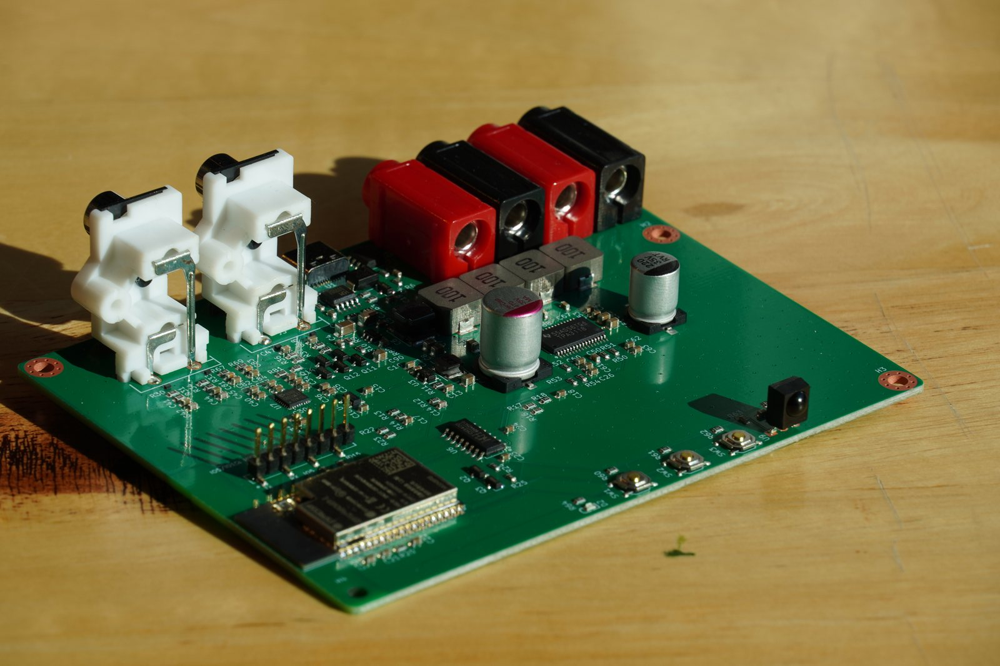
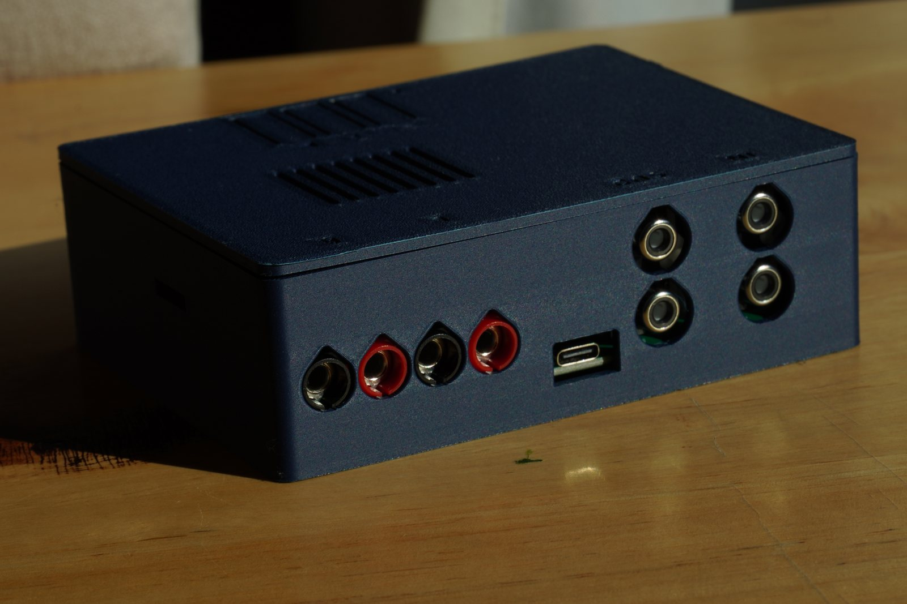
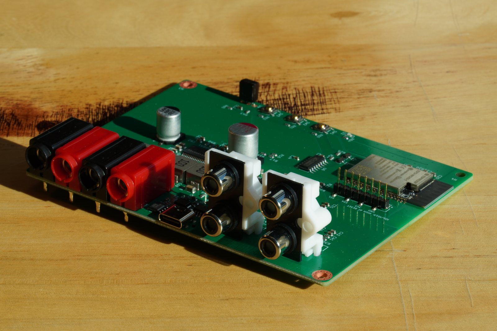
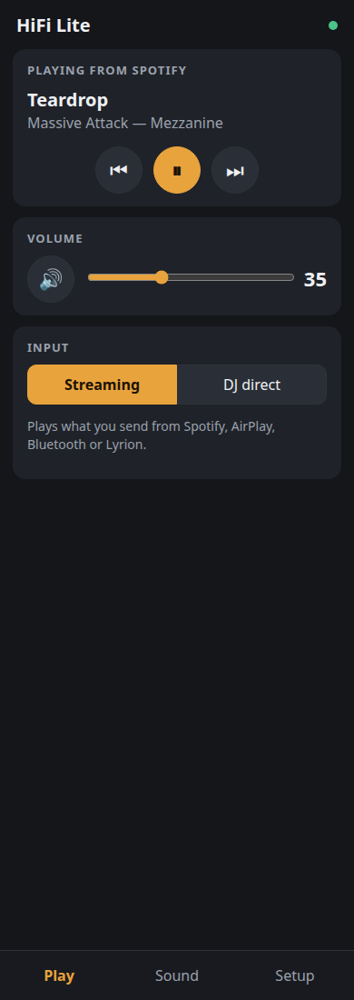
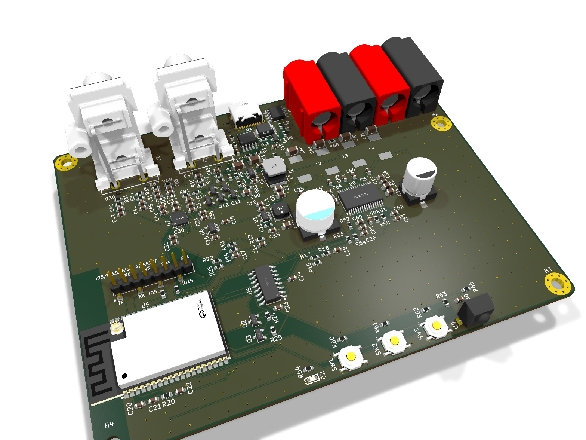

# HiFi Lite

**A streaming stereo amplifier on one 118 × 90 mm board, powered from a USB-C laptop charger.**

Plug in a 65 W USB-C charger and a pair of passive speakers. It plays Spotify
Connect, AirPlay, Lyrion (LMS) and Bluetooth, takes a DJ deck or any line source
on RCA, drives a subwoofer from an RCA sub out, and is set up and controlled
from a web app on your phone, three buttons or any IR remote.



The board, its firmware, its web app, its 3D-printed case and its test bench
were designed by AI agents built on Claude, under the direction of one
person. The agents ran on [Hive](https://hivelab.ca/), where agents start
and resume one another through shared project threads on a message board.
Every file the agents produced is here: the KiCad project, the
scripts that generated the schematic, the simulations, the checks and
reviews, the firmware, the case in code, and the reports from the five
boards that were built. This page is the five-minute version.
**[DESIGN.md](DESIGN.md)** is the full record.

**One decision, followed through.** The person asked for a board that could
check itself. The agents answered with a resistor divider on each speaker
output, feeding it back into the codec's spare ADC: about $0.04 a board.
Those loopback taps let the agents play a signal through the real amplifier
and record what came out, over the network, with nobody at the bench. That
gave a self-test on all five boards and frequency response, distortion,
noise and crosstalk on three. It also caught a fault a one-board demo would
have hidden: the first self-test after a flash failed, and every later run
passed. The agents traced it to four start-up races in the firmware and
fixed them. On each of two boards, the fixed image was flashed and then
self-tested 25 times across 12 restarts, and all 25 passed on both. The old
image, flashed again on one of them as a control, still failed its first
self-test, twice.

| | |
|---|---|
|  |  |
| The snap-fit 3D-printed case, no screws | Speaker terminals, USB-C, line in and sub out |
|  |  |
| The web app, served by the board itself | The KiCad 3D render it was built from |

## How the agents worked

| Pattern | What happened on this board | Record |
|---|---|---|
| **Fresh-context review** | The electrical rule check passed, but every pin was typed as passive, so it could not see much. A review agent with none of the design history found the amplifier rail's soft-start capacitor on the wrong node, with an estimated 20 to 40 A of inrush at turn-on. A second independent review simulated the first fix and found it still too fast. After the second fix, before the order, it simulates at about 0.41 A. | [Decision trail](docs/decision-trail-soft-start.md), [review](hardware/reports/review-schematic-response.md) |
| **Revisiting an upstream decision** | The first USB-C PD controller chosen, a CH224Q, came in a 0.4 mm-pitch package that could not be fanned out under the USB-C connector on two layers. The agent routing the board went back to the part choice and swapped it for the CH224A, which has the same die, price and stock in a 1.0 mm-pitch package. The record is a snag note; the failed routing attempt was not kept. | [Snag #25](hardware/HWDE-SNAGS.md) |
| **Improving the tools** | 20 of 21 imported footprints had courtyards that didn't cover their own pads. *On this board:* repaired by a local script. *In the shared tool:* the same day, a courtyard check and an automatic repair landed in the agents' PCB tooling. That was separate work, not triggered by this board. *On a later project:* not verified. A second case: the person spotted an RCA jack clashing with a speaker post in a render of the bigger board, and the agents added a 3D body-clash check to the shared tooling, which then caught that clash by itself. | [Snag #9](hardware/HWDE-SNAGS.md), [fix_courtyards.py](hardware/lib/fix_courtyards.py), [check_courtyard](https://github.com/Hive-RSI-Lab/hive-pcb-flow/blob/main/scripts/check_courtyard.py), [check_body_clash](https://github.com/Hive-RSI-Lab/hive-pcb-flow/blob/main/scripts/check_body_clash.py) |
| **Designing for remote measurement** | The loopback taps above, plus a remote bench that flashes, tests and reads boards from anywhere. Five boards became a lab the agents ran around the clock, and lanes for security, tests and features shared them. | [Audio measurements](DESIGN.md#audio-measurements), [remote bench](docs/remote.md) |

The person set the goals, made the owner's calls (all parts on the top
side, the order, its cost), did everything that needed hands, and spotted
several problems first, among them an RCA jack against a speaker post in a
3D render that every automated check had passed.
[Who did what](docs/who-did-what.md) separates their part from the agents',
with a timed trace of the first bring-up.
[How the agents worked](docs/agentic_flow.md) has the timeline, the 445
recorded board-family engineering runs and what they cost.

## What is shown, and where it stops

| Claim | Evidence | Where it stops |
|---|---|---|
| All five boards pass their self-test | [Self-test reports](docs/lab/reports/README.md) | The self-test checks the 20 V USB-C contract, the supply rails, the codec, the amplifier's fault line, free memory, and a −20 dB tone round trip on each channel within ±3 dB, with crosstalk. It does not measure output power or distortion. |
| Audio was characterised on three boards | [Audio measurements](DESIGN.md#audio-measurements) | Lites 2, 3 and 4. The figures are for the whole chain: DAC, amplifier, divider and a 16-bit ADC. The divider scale comes from resistor values and was not calibrated against a meter, and the ADC's noise dominates the THD+N figures, so they are not the amplifier's own. Lites 1 and 5 were not measured. |
| The first-flash self-test fault is fixed | [Loopback fix](DESIGN.md#audio-measurements), [test record](docs/lab/hifi-lite-tests.md) | 25 of 25 self-tests on Lite 2 and 25 of 25 on Lite 3. Each board had one flash of the fixed image (Lite 3 over Wi-Fi), a self-test, then 12 restarts with two self-tests after each. Control: the old image on Lite 3 failed its first self-test after a flash twice, so the fault follows the image. The restarts were software reboots through the board's API, not power cuts. Lites 1, 4 and 5 were not run. |
| The Wi-Fi reconnect leak is fixed | [Soak report](docs/lab/reports/README.md), [30-reconnect run](docs/lab/reports/hil/lite-5-20261117-wifidrop-result.json) | A 7.7-hour soak showed a 736 B step in free memory at a Wi-Fi drop, about 730 B lost per reconnect. After the fix, 30 forced reconnects on Lite 5 netted −112 B, which is noise. The long soak with the fix has not been run. |
| The soft-start limits inrush | [Decision trail](docs/decision-trail-soft-start.md) | Simulated only: 0.36–0.43 A peak across component tolerance. Nobody has scoped it on a built board. The boards switch the rail on correctly. |
| Power output | [Power, plainly](#power-plainly) | 38.7 W per channel is calculated, not measured. 9 W per channel sustained is the firmware's modelled default. Continuous output at a stated THD+N, in the closed case, is still to be measured. |

## What it is

| | |
|---|---|
| **MCU** | ESP32-WROVER-E (8 MB flash, 8 MB PSRAM): Wi-Fi and Bluetooth Classic |
| **Codec** | Everest ES8388: DAC for the amp and the sub out, ADC for the line in |
| **Amplifier** | TI TPA3118D2 class-D, bridge-tied, into 4–8 Ω speakers. What it delivers on a 65 W charger is set by the firmware: see [Power, plainly](#power-plainly) |
| **Power** | USB-C PD sink (WCH CH224A) asking for 20 V; runs on a 65 W or larger charger, with a power governor that keeps the amp inside the charger's contract |
| **Sources** | Spotify Connect, AirPlay, Lyrion/LMS, Bluetooth A2DP, RCA line in (DJ direct mode) |
| **Outputs** | Four 4 mm banana sockets for the speakers, RCA sub out (L/R) |
| **Controls** | Web app, three buttons (−, +, play/pause; hold for track skip and standby), IR receiver that learns your TV remote |
| **Board** | 118 × 90 mm, 2 layers, 1.6 mm FR-4, 154 parts all on the top side, assembled by JLCPCB |
| **Cost** | about $14.54 a board in parts, assembly and PCB at 100 units ([docs/bom-estimate.csv](docs/bom-estimate.csv)) |
| **Firmware** | [squeezelite-esp32](https://github.com/sle118/squeezelite-esp32) plus our own component: power sequencing, the governor, test signals, the test API and the web app |

### Power, plainly

The amplifier chip can do more than a laptop charger can feed, so the
firmware decides what you get:

| | Per channel, 4 Ω | Where it comes from |
|---|---|---|
| Chip limit at 1 % THD, unlimited 20 V supply | 38.7 W (43 W on the product page) | Calculated in design review; the 43 W is scaled from a 12 V bench test of another TPA3118 board. Not measured on the Lite. |
| Short bursts on a 65 W charger | about 24 W (49 W total) | The governor keeps input under 90 % of the charger's contract, averaged over 50 ms |
| Sustained, by default | 9 W | The governor's heat model, averaged over 30 s, keeps the amp chip below its shutdown temperature in the case |
| Sustained, maximum setting | 15 W | Set in the app; above 9 W the amp may trip on heat, and the firmware backs off |

Music averages about an eighth of its peaks, so normal listening sits under
both limits. Not yet measured: both channels driven into 4 Ω with burst
power, sustained power, THD+N and the temperature inside the closed case,
reported together. That is the first measurement on the
[open list](DESIGN.md#open-questions).

Five boards were built and brought up; all five pass the self-test. The
measurements are in [docs/lab/reports](docs/lab/reports/README.md).

## What's in this repo

| Folder | What |
|---|---|
| [`hardware/`](hardware/README.md) | The board: KiCad 10 project, schematic generator, part data, placement and routing scripts, simulations, check reports, design reviews and the JLC fab package (`hardware/fab/`) |
| [`firmware/`](firmware/README.md) | The ESP32 firmware: the pinned upstream, our patch, our `hifi` component, host unit tests and the build scripts |
| [`app/`](app/) | The web app the board serves (built into the firmware), its mock server and tests |
| [`enclosure/`](enclosure/README.md) | The case, as build123d code fitted to the KiCad board, with STL, STEP and sliced print files |
| [`bench/`](bench/README.md) | Bring-up and test from a laptop: find, flash, self-test, power sweep, thermal soak |
| [`docs/`](docs/) | The [user manual](docs/manual/user-manual.md), [bring-up guide](docs/bringup.md), [firmware design](docs/firmware.md), [app](docs/app.md), [test API](docs/test-api.md), [product plan](docs/product.md), [known unknowns](docs/known-unknowns.md) and the lab reports |
| [`DESIGN.md`](DESIGN.md) | How it was designed, from the brief to the bench |

The firmware and the case are shared with two bigger boards in the same
family (Plus and Ultra, on a common core board). Their build targets are left
in `firmware/board/` so the build matches what was flashed, but this repo is
about the Lite.

## Build it yourself

### Order the board

`hardware/fab/` has what JLCPCB asks for: `lite-main_gerbers.zip`, `BOM.csv`
and `CPL.csv` (LCSC part numbers, rotations checked against the 3D models).
Order 2 layers, 1.6 mm, 1 oz copper, OSP finish, top-side assembly. The four
banana sockets overhang the rear edge by design and need an order remark, and
a few parts may need pre-buying (`hardware/fab/prebuy.csv`); read the
ordering notes in [hardware/README.md](hardware/README.md) first.

### Build and flash the firmware

Run the host tests first (no board and no ESP-IDF needed):

```sh
make -C firmware/test
```

Then, with ESP-IDF v4.4.8 installed ([firmware/README.md](firmware/README.md)
has the steps):

```sh
firmware/tools/build.sh                       # fetches upstream, patches, builds
cd ~/fw-build/squeezelite-esp32 && idf.py -p /dev/ttyUSB0 flash monitor
```

The board's USB-C port is also its serial console (CH340B), so flashing needs
no extra adapter. Spotify Connect needs your own free Spotify developer app
key at build time (`SPOTIFY_CLIENT_ID` / `SPOTIFY_CLIENT_SECRET`); nothing
secret is in this repo.

### Print the case

`enclosure/out/lite-snap/` has the screwless snap-fit case as STL and STEP,
and sliced files for a Bambu A1 mini. `enclosure/out/lite/` has the screwed
version. Print in PETG or ASA if the amp will run hot; see
[enclosure/README.md](enclosure/README.md).

### Set it up

Power it from a 65 W+ USB-C PD charger, join its own `hifi-lite-…` Wi-Fi
network from your phone, and the web app walks you through joining your home
Wi-Fi.
The [quick start](docs/manual/quick-start.md) has the rest.

## How it was made

The agents worked through the same steps a hardware team would: a product
plan, part choices against cost and availability, a schematic written as
Python, placement and routing with scripted checks, SPICE and thermal
simulations, rounds of design review by separate agents, a fab package,
firmware tested on a PC and in QEMU before any board existed, a case fitted
to the board in code, and then bring-up on real boards through a remote test
bench. A person approved the order, paid for it, and plugged things in.
[DESIGN.md](DESIGN.md) covers each step, what went wrong, and what the next
board would change.

## Status

A first spin. Five boards were built and all pass self-test; one is in
everyday use as a listening amp. The open items, including measurements still to
make, are in [docs/known-unknowns.md](docs/known-unknowns.md) and at the end
of [DESIGN.md](DESIGN.md).

## Third-party code

The firmware builds on
[squeezelite-esp32](https://github.com/sle118/squeezelite-esp32) and
ESP-IDF, fetched at build time at the commit in `firmware/upstream.lock`;
`firmware/third_party/` holds the small pieces vendored in, with their own
licenses. Part footprints and 3D models come from the KiCad libraries and LCSC.

## Reading the working docs

Most documents under `hardware/`, `docs/` and `docs/lab/` are the agents'
own working notes, kept as they were written. A few words in them are
local:

- **the person:** the human who directed the agents, approved the order
  and did the hands-on steps.
- **the Hive, H0, H2:** the groups of AI agents that did the work. H0 did the
  board design in October 2026; H2 took over from 2026-10-31 for ordering,
  bring-up and the firmware work on real boards.
- **the tower:** the build machine the agents ran on.
- **task numbers, issue and PR numbers** (`#136`, `task 261030-140102`):
  references to the working repo the design came from.
- **lite-1 … lite-5:** the five boards that were built.
