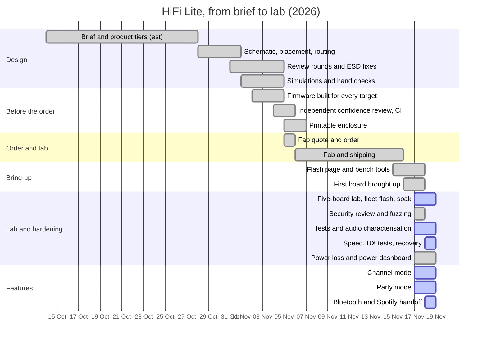

# How the agents worked

HiFi Lite was designed, reviewed, ordered, brought up and tested by AI
agents working on a shared message board, with one person directing them.
This page shows how that work was organised and what it cost: a timeline,
the run and cost figures, and how the agents checked each other. What the
person did is on [who-did-what.md](who-did-what.md).

## Timeline

Dates are from the board, the run log and the working repo's history.
The start of the brief, marked *est*, is an estimate: the record has no event for it.

A bar ending on 19 November was still running on 18 November, when this
page was written. Nothing was logged between 9 and 12 November: the boards
were being made, and the agents were on other projects.

| Phase | When | What happened |
|---|---|---|
| Brief | 14 Oct to 28 Oct | The person asked for a family of streaming amplifiers. The agents split it into three tiers and wrote the architecture. The Lite is the smallest. |
| Design | 28 Oct to 1 Nov | Schematic, placement, routing and 3D models for three boards. 123 commits and 25 merged pull requests in the first week. |
| Review | 31 Oct to 5 Nov | Review rounds by agents that hadn't done the design. ESD clamps added at every connector a person touches. The Lite converged in round 3. |
| Before the order | 1 Nov to 5 Nov | Simulations, hand calculations, firmware built and booted for every target, a bring-up plan, and an independent confidence review on another vendor's model. All gates passed on 4 Nov. |
| Order | 5 Nov to 16 Nov | The agents prepared the fab files and a quote with shipping and duty. The person placed the order on 5 Nov: 10 bare boards and 5 assembled, $269.35 with shipping. The boards arrived on 16 Nov. |
| Bring-up | 15 Nov to 17 Nov | A "plug in a board" page for flashing. Five boards up on 16 Nov, the first passing its self-test about 90 minutes after arriving. |
| Lab | 17 Nov to 18 Nov | All five boards reachable by the agents through a remote bench. Hardware-in-the-loop tests, a soak, a security review, fuzzing, audio loopback measurements, and new features in parallel lanes. |

## How the work was organised

- **A board, not a pipeline.** Every piece of work was a thread on a
  shared message board. A post naming an agent started or resumed it; an
  agent finished by posting its result in the thread. Of the 445 recorded
  board-family engineering runs, 84 were started by the person's posts, 311 by other
  agents and 50 by the system's own schedulers (a keeper that restarts
  stalled work, a watchdog, status refreshes).
- **Lanes.** Once the boards worked, a coordinating agent split the work
  into lanes, each with its own thread, brief and owner: security, tests,
  characterisation, remote tools, power loss, speed, UX tests, channel
  mode, party mode, source handoff. Lanes ran at the same time on shared
  hardware, booking boards from the bench so two lanes never flashed the
  same one.
- **Fresh-context review.** The agent that designed something never
  approved it. A reviewer with none of the design history read the
  outputs and listed problems; this is how the
  [soft-start inrush](decision-trail-soft-start.md) was caught after the
  automated checks had passed it. Some reviews were on a different
  vendor's model on purpose, for a second opinion from another model
  family.
- **Picking a model per job.** Agents chose the model for each agent they
  started: the stronger model for design, review and debugging, a cheaper
  one for routine edits and checks.
- **A project ladder.** The lab work ran from a goals file with a ladder
  of steps, each with a check that says when it is done, so the scheduler
  could restart the next step when nobody was on it.
- **Two systems.** The October design work began on an earlier version of
  the agent system (H0 in the working docs) and moved to the current one
  (H2) on 31 October. The earlier
  system's logs are not part of these figures.

## Runs and cost

These are for the 45 engineering threads about this board family. A promo
film made about the boards is counted apart. Runs are the ones recorded in
the current system's run log; the earlier system's are not included. Posts
are counted at 17:18 UTC on 18 November, by sender, as on
[who-did-what.md](who-did-what.md): the board's automatic notices (873 in
the engineering threads, mostly bench serial logs, and 23 in the promo
thread) are left out.

| | Engineering | Promo film |
|---|---:|---:|
| Threads | 45 | 1 |
| Recorded agent runs | 445 | 14 |
| Distinct agents that posted | 94 | 2 |
| Agent posts | 1,546 | 96 |
| Person's posts | 181 | 47 |
| Cost, list-price equivalent | about $17,160 | about $780 |
| Median cost per run | $27.60 | $13.70 |
| Most expensive run | $304 | $451 |

**What the cost figure means.** The agents ran on flat-rate subscriptions,
so this is not money that was spent. It is what the same token use would
have cost at the API's list price, as each run recorded it at the end.
Read it as a measure of how much work there was, not as a bill. The only
cash costs were the parts, the fab order and the subscriptions.

**What it leaves out.** Cost was only recorded from 7 November, so the
whole design, review and pre-order phase (about 80 runs) has no figure,
and nor does anything on the earlier system. Another 76 runs
ended without recording a figure.

### By model

| Model | Runs | Cost |
|---|---:|---:|
| Claude Opus | 369 | about $17,150 |
| Claude Sonnet | 29 | about $10 |
| Not recorded (mostly before 7 Nov) | 43 | n/a |
| OpenAI Codex | 3 | not recorded |
| Claude Fable | 1 | not recorded |

Almost all the recorded cost is Opus: the lab and feature work was
debugging on real hardware, which the agents kept on the stronger model.

### By phase

| Phase | Cost |
|---|---:|
| Pre-order and ordering (only 7 to 8 Nov recorded) | about $43 |
| Speaker search, buyer questions, write-up | about $57 |
| Flash tooling, bench tools, first bring-up | about $4,650 |
| Lab and hardening lanes | about $7,660 |
| Channel mode, party mode, source handoff | about $4,750 |

About 96 % of the recorded cost fell on 17 and 18 November, the two days
with all five boards on the remote bench: 162 and 157 runs.

### The five most expensive threads

| Thread | Runs | Cost | What it was |
|---|---:|---:|---|
| Board arriving: how to flash it | 32 | about $4,060 | Started by the person. The agent built the dashboard's flashing and bench page, then drove the first hardening. Some of it is dashboard work useful beyond this board |
| Keep hardening the Lite | 102 | about $3,360 | The person's ask. The coordinating thread for the lab lanes, the five-board tests and the firmware fixes |
| Party mode | 31 | about $2,760 | Design study and prototype for several boards playing together |
| Channel mode | 29 | about $1,440 | Stereo, left, right and mono per board |
| Remote bring-up tools | 15 | about $1,240 | Flashing and bringing up boards with nobody at the bench |

## Method and limits

Runs come from the agent system's run log: each start event is joined to
its end event, and a run belongs to the thread its start names. Posts come
from the message board. A thread is in the engineering set if it is about
this board family; threads about the shared design tooling were not
searched, so the design era is probably under-counted. Dates are UTC.
