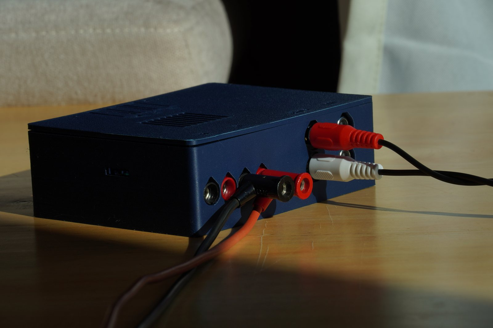

# Who did what

HiFi Lite was built by AI agents under the direction of one person: the
owner of the project, who wanted the amplifier and paid for it. This page
separates their parts, so a reader can judge how much of the work ran on
its own and where a human was needed. It is built from the project's
message board and working repo; [Method and limits](#method-and-limits) says
what was and wasn't searched.

**In numbers:** across the 46 message threads about this board family, the
person wrote 228 posts and the agents 2,538. The person wrote about one post
in twelve. What those posts were about matters more than how many there
were, and the sections below list them.

## What the person did

### Set the brief (14 October to 4 November)

- **14 and 28 October:** asked for a streaming amplifier family like a
  commercial Wi-Fi receiver, in several tiers, powered over USB-C and
  cheap to build, with the agents to "take care of everything".
- **29 October:** set how the work would be shared out. The person would
  give the spec, place the order and plug the boards in; everything else
  was the agents'. The person asked that the board be able to check
  itself. The agents designed how: the speaker-output loopback taps and
  the switch that isolates them.
- **29 October:** said every board in the family had to be finished and
  working, and named the speakers it would drive (6 Ω).
- **4 November:** lifted a pause on the work with the condition for
  ordering: firmware, a bring-up plan and simulations done, and the board
  sure to work on the first spin. That condition is why the boards
  went through the independent pre-order reviews.
- **16 November:** set the case requirements: printable on a small
  printer, no glue, M2/M3 screws, and later a screwless snap fit.

### Made the calls that belong to the owner

- **31 October:** put all parts on the top side of the Lite to keep
  assembly cheap.
- **1 November:** accepted that the boards came in a little over the cost
  target, and picked which variant of the bigger board to build.
- **5 November:** asked the fab house to place the one header that would
  otherwise need hand soldering, and asked for spare ports in case the
  audio path failed. Questioned the cost when a quote came to about $330,
  checked the ground stitching and the antenna keep-out, then placed and
  paid for the order: 10 bare boards and 5 assembled, $269.35 with
  shipping.
- **16 November:** required that the boards reach the agents through an
  outside relay, without the person's laptop and without opening the home
  network.
- **16 November:** told the agents to install firmware updates on the
  boards without asking.

### Spotted problems before the agents did

| Date | What the person saw | What the agents then found |
|---|---|---|
| 1 Nov | In a 3D render of the bigger board, an RCA jack sat against a speaker post | Every automated check had passed it. The agents added a 3D body-clash check to the board tooling |
| 16 Nov | The case's button pushers didn't reach the buttons and fell into the box | The lid was redesigned with spring tongues |
| 16 Nov | Streaming to board 1 gave no sound | The board was running out of memory; buffers were moved and shrunk |
| 16 Nov | Bluetooth pairing failed and the board restarted | Also memory: Bluetooth buffers cut from 12 to 8 |
| 17 Nov | Spotify worked for the person but not for a friend | Phones were being told the speaker was in use by someone else |
| 17 Nov | Changing EQ or bass boost in the app "breaks it", and some settings did nothing | EQ allocated memory the board didn't have (about 11 KB free) |
| 17 Nov | Board 3 power-cycled when its USB-C plug shifted | This also ended the 7.7-hour soak; USB-C disconnects are now a tested failure mode |

### Did everything that needed hands

- Unboxed the five boards on 16 November and flashed the first one over
  USB. Moved boards between the laptop and USB-C chargers, power-cycled
  and re-plugged them when the agents asked, and listened to the first
  test tones.
- Printed every version of the case on a Bambu A1 mini, including a print
  that failed and the snap-fit lid that didn't latch.
- Connected the sub out to a portable speaker, wired an outboard amp with
  clip leads, and found speakers to test with.
- Filmed the boards.

No soldering by the person appears in the record: they asked the fab
house to place the one header that would have needed it.

### Asked for features

Button taps like a headphone's, no number matching when pairing
Bluetooth, a graceful stop during updates, more volume (which became the
Boost and heat-cap settings), mono/stereo and party mode across several
boards, power figures on the dashboard, flashing from the dashboard, and a
chime and button combination for Bluetooth pairing.

## What the agents found on their own

Nobody pointed the agents at these. They came out of reviews, checks and
tests the agents ran themselves:

- **The soft-start inrush.** A fresh-context schematic review found the
  amplifier rail's soft-start capacitor on the wrong node, with an
  estimated 20 to 40 A of inrush at turn-on. The schematic check had passed
  it. A second review, which followed the person's "must work first time"
  bar, simulated the first fix and found it still too fast. The final
  circuit simulates at about 0.41 A. The person never named the capacitor.
  See the [decision trail](decision-trail-soft-start.md).
- **The Wi-Fi reconnect leak.** A soak test showed a 736 B drop in free
  memory at a Wi-Fi drop. The agents traced it to about 730 B lost per
  reconnect, patched it, and showed 30 forced reconnects with no loss. The
  person's part was moving the board.
- **The first-flash self-test race.** The loopback self-test failed on the
  first run after a flash and passed afterwards. The agents found four
  start-up races and fixed them, then got 25 of 25 passes.
- **Bring-up faults on the first day.** A blank recovery app, a serial
  console that took one character at a time, a checksum bug in the bench's
  recovery image, and a memory self-test failing at 17.4 KB against a
  20 KB floor. All four were found and fixed within two hours of the
  boards arriving.
- **Review findings on the bigger board,** such as a too-small capacitor
  in its power stage and vias in pads on the Lite. The
  [design reviews](../DESIGN.md#design-reviews-and-pre-order-rounds) list
  them all.

## One trace: first power-up to a passing self-test

16 November, from the boards arriving to the first board passing its
self-test, about an hour and a half. Rows marked **Person** are the
person's.

| Time (UTC) | Who | What happened |
|---|---|---|
| 17:35 | **Person** | "The boards are here." Flashes board 1 twice over USB |
| 17:49 | Agent | Finds why the board boots its recovery app: the flash image starts with a blank boot-selection area. Fixes the build |
| 18:46 | Agent | The main app now boots. Finds the serial console taking in one character at a time, a firmware bug |
| 18:52 | Agent | Finds a checksum bug in the bench's recovery image |
| 19:01 | Agent | The self-test fails: 17.4 KB of free memory against a 20 KB floor |
| 19:05 | Agent | Moves the tone and line-in task memory to PSRAM; the self-test passes |
| 19:16 | **Person** | The case's button pushers fall into the box: a case redesign begins |

The person-first trace came the same evening. At 21:25 the person
reported that streaming gave no sound, and at 21:37 that Bluetooth pairing
failed. The agents traced both to the board running out of memory; the
Bluetooth fix was on four of the five boards by 22:52.

## Method and limits

The lists come from every post the person wrote in the 46 threads about
this board family, plus seven related posts elsewhere, from the working
repo's history, and from the agents' written digests of the October work.
That work ran on an earlier system, whose raw transcripts were not
searched, so October may be under-counted. Times are when the messages
were posted. How the agents organised the work, and what their runs cost,
is in [agentic_flow.md](agentic_flow.md).
