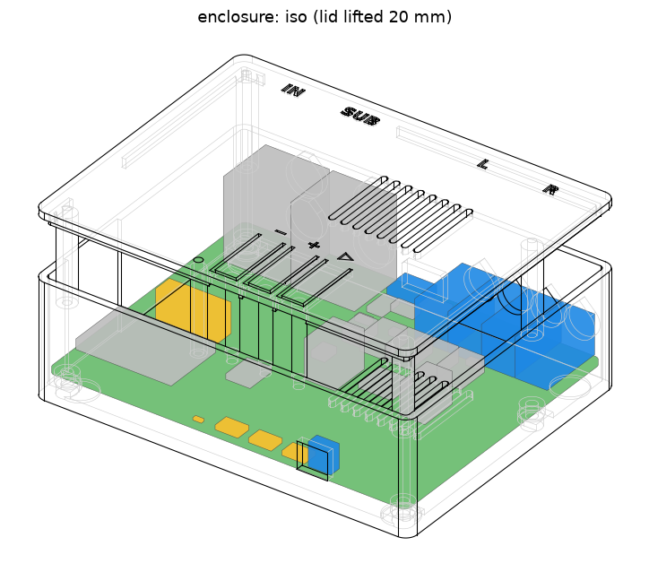

# Enclosure

3D-printable enclosures for HiFi Lite, made in code (build123d), fitted
to the board's KiCad file, and exported as STEP and STL. Each box is
read, built, rendered and fit-checked with hive-mech's `mech`: `lite.py`
(screwed) and `lite_snap.py` (screwless, snap-fit) are `mech build`
scripts, and the pieces they share (pillars, RCA holes, banana-socket
holes, light pipes) are in `core_box.py`, which also serves the bigger
Plus and Ultra boxes in the main project.

The brief asked for Onshape. The Hive has no Onshape account or key (nothing
in `/hive/tools` or the knowledge base), so the model is code in this repo.
STEP moves it to Onshape later (see the end of this page).

## Lite



- **Box:** 124 x 96 x 39.8 mm: a base (the tray) and a lid. The three
  buttons are spring tongues cut into the lid, one piece with it (see Buttons).
- **Files:** `out/lite/base.stl` and `lid.stl` are already
  in print orientation. `out/lite/enclosure.step` is the assembly with the
  board as a slab, for Onshape.
- **Print files:** `out/lite/a1mini/lite-base.3mf` and `lite-lid-buttons.3mf`
  are sliced for the A1 mini; see Printing.
- **Fit:** `out/lite/fit.md` is the fit check's report against the board.
- **Material:** about 110 g if printed solid, so about $2–3 of filament.

### Printing

- **Material:** PETG or ASA, not PLA. The amp heats the inside, and PLA
  softens at about 55 °C.
- **Settings:** 0.4 mm nozzle, 0.2 mm layers, 4 walls, 20–25 % infill.
- **No supports.** The base prints on its floor, the lid on its top face, so the
  button tongues and plungers grow straight off the bed. The holes in the walls are teardrops (RCA: cut
  flat 1 mm over the hole, a 3 mm bridge), rounds with a 45-degree roof (the
  banana sockets) or bridge (USB-C, IR window). Each standoff has a 7.8 mm foot round its 6.2 mm
  counterbore, so the ring left round it is two nozzle lines. The foot joins
  the wall beside it.
- **Bed:** every part fits the A1 mini's 180 x 180 x 180 mm bed, but the base
  and lid don't fit one plate, so there are two plates.
- **A1 mini files** (`printer slice`, Bambu PETG Basic, Textured PEI Plate):

  | Plate | File | Time | Filament | Brim |
  |---|---|---|---|---|
  | Base | `out/lite/a1mini/lite-base.3mf` | 1 h 48 | 63 g | none |
  | Lid with spring buttons (PLA Matte, supports on) | `out/lite/a1mini-pla/lite-lid-pla.3mf` | 1 h 18 | 34 g | none |

  Re-slice after any rebuild; `--set` carries the settings above:

  ```
  L=enclosure/out/lite
  printer slice $L/base.stl --name lite-base --model a1mini --out $L/a1mini \
    --filament "Bambu PETG Basic" --plate "Textured PEI Plate" \
    --set wall_loops=4 --set sparse_infill_density=25% --set brim_type=no_brim
  printer slice $L/lid.stl --name lite-lid-pla --model a1mini --out $L/a1mini-pla \
    --filament "Bambu PLA Matte" --plate "Textured PEI Plate" \
    --set wall_loops=4 --set sparse_infill_density=25% --set enable_support=1 --set support_type="tree(auto)"
  ```

### Buttons

The loose buttons fell out of their holes and missed the switches, so Lite's
are now part of the lid (`keys()` in `lite.py`). Each is a 7 mm tongue inside
a 1 mm U-slot through the lid, rooted 22 mm back from the front edge. A
full-thickness pad sits at the front, over the switch. Behind the pad the arm
is thinned to 1 mm from underneath, so it flexes. A 4 mm plunger with a 3 mm
tip hangs from the pad and stops 0.4 mm above the switch. Pressing the pad
bends the arm about 0.65 mm and clicks the switch; the arm springs back. The
lid's lip is cut away under each pad's front edge.

### Screwless (lite_snap.py)

`lite_snap.py` builds the same box with no screws (`out/lite-snap/`). The
board drops onto a 2.85 mm pin in each mounting hole, and the lid's posts come
down to 0.3 mm over the board round each hole, so the board can't move once
the lid is on. The lid clicks on: a 1.6 mm x 18 mm hook hangs inside the W and
E walls at y = 50, and its 1.8 mm catch springs out into a window in the wall
that leaves 0.6 mm of play over it. (The first version, a 1 mm catch with
0.1 mm of play, didn't engage.) To open,
push each catch in through its window (pen tip or fingernail) and lift that
side. Print files: `out/lite-snap/a1mini-pla-base/lite-snap-base.3mf`
(1 h 47, 72 g) and `out/lite-snap/a1mini-pla-lid/lite-snap-lid.3mf`
(1 h 23, 36 g), PLA Matte, same settings as the lid above. If the catch is too stiff or too
loose, change `CATCH` or `HOOK_T`; if the board won't drop on, change `PIN_D`.

### Antenna

The ESP32 module's antenna is at the west edge, so `lite.py` keeps the box out of
its way:

- **Wall:** 1.2 mm instead of 2.4 mm beside the module, 2 mm past it each way.
  The cut is open at the top, so it prints without an overhang.
- **Lid:** the locating lip stops over that stretch.
- **Keep-out check:** the build fails if the base, lid or a button enters the
  zone from the inner wall face to the antenna's inner end, between floor and
  lid. The zone comes from U5's position, so it follows the module.
- **Still near it:** 1.2 mm of PETG about 1.2 mm from the module's edge, the 2 mm
  floor about 5 mm under the board, and the steel M3 in H4, 8.2 mm from the
  module's corner (centre to edge).
- **Not measured:** nobody has tested how the box detunes the antenna. Compare
  Wi-Fi signal strength with the box on and off at bring-up. If the screw matters,
  a nylon M3 in H4 is the first thing to try; cut the thread with a steel screw
  first.

### What else it needs

| Item | Qty | Note |
|---|---|---|
| M3 x 12 screw, socket or pan head | 4 | Threads straight into the lid's pillars (2.5 mm pilot), no inserts. |
| Rubber foot, ≤ 11 mm dia | 4 | Self-adhesive. The underside has 0.8 mm recesses for them. |

### Assembly

1. Drop the board onto the four standoffs, with its connectors to the rear
   wall: tilt it nose-first so the four banana sockets' round collars go into
   their round holes, then lay it down. The RCA and USB-C sockets line up
   with their holes. There is no wiring: the speaker sockets are on the board.
2. Put the lid on: its lip locates it inside the walls, and each button's
   plunger lands over its switch by itself.
3. Fit the four screws from underneath. Each one goes through the base and
   the board's mounting hole into a lid pillar. Together they clamp the board
   and hold the lid. Don't overtighten them: the thread is plastic.

### Panels

- **Rear, seen from behind, left to right:**
  - the speaker outputs, four 4 mm banana sockets low down at 11 mm pitch,
    7.5 mm over the board: R- R+ (right speaker) then L- L+ (left speaker).
    Red is +, black is -. Single banana plugs; a dual (19 mm) plug doesn't fit.
  - USB-C power, low down
  - SUB OUT, an RCA pair
  - LINE IN, an RCA pair, for the FLX4

  In each RCA pair the upper jack is left (white) and the lower one is right
  (red).
- **Front:** a window for the remote, at the bottom right seen from the
  front. Behind it is the IRM-3638T receiver, with its lens facing forward.
- **Top:**
  - three buttons along the front edge, left to right: vol−, vol+ and
    play/source (hold for Bluetooth pairing). Each is a printed plunger: a
    4.6 mm cap through the lid, a flange under the lid that keeps it in,
    and a stem down to 0.3 mm over its switch.
  - the status LED's light pipe, to the left of the buttons
  - vent slots over the amplifier. Keep them uncovered.
- **Underside:** floor vents under the amplifier and the four feet. No label
  recess: its roof would be a 22 mm bridge off the bed.

Labels are debossed 0.5 mm into the lid's top face, which prints face down,
so nothing overhangs: − + ▶ behind the three buttons, and along the rear edge
IN, SUB, L and R over their ports (L and R once over each terminal pair),
read from the front. The rear wall itself stays bare: letters cut into a wall
that prints upright would each need support inside. fit flags wall_lid on two
0.2 mm slivers in the N's acute corners; they are cosmetic (the slicer drops
them), so 30/31 is expected.

### How it is fitted

`lite.py` places every feature from `lite-main.board.json` (mech's read of
the board), so a moved hole or connector moves its cut-out. It is in mech's
board frame: x along the front edge, y back (the rear wall is the N edge),
z = 0 the board's bottom face. The dimensions behind it:

| | mm | why |
|---|---|---|
| Wall | 2.4 | 6 perimeters |
| Floor | 2.0 | |
| Lid | 2.2 | |
| Board edge to wall | 0.6 | |
| Standoff | 5.0 | RCA pins stick out 2.9 mm under the board |
| Board top to lid | 29.0 | RCA pair 27 mm tall, and 2 mm over it |
| RCA holes | 12.0 | a plug's outer shell, over the 8.3 mm barrel |
| USB-C opening | 13.4 x 7.6 | mech's USB-C plug (12.4 x 6.6) + 0.5 a side |
| IR window | 9 x 8 | round the lens, 5 mm over the board |
| Banana-socket holes | 10.2 round, teardrop roof | the sockets' 9.5 mm round collar (Amass drawing; it reaches 2.65 mm past the board edge, into the wall) + 0.3 a side |

Before mech's check sees the board, `lite.py` cuts the RCA jacks to their
body inside the rear wall with a port per barrel, cuts the banana sockets
(J4-J7) the same way with their round collar as the port, and makes U9's lens
a port through the front wall.

Part heights come from `heights.json`: the parts' STEP models and LCSC's
seated heights. The stacked-RCA model in the board library sits 13.5 mm too
low and 6.1 mm too far in, so its heights are corrected by hand. Barrel axes
are 6.5 and 20.5 mm above the board. A footprint not in `heights.json` gets
mech's height (its 3D model, the name, a package table, else 5 mm with a
warning).

### Rebuild and check

```sh
# mech is hive-mech: https://github.com/Hive-RSI-Lab/hive-mech
M=path/to/hive-mech/bin/mech                 # builds its venv in ~/.cache/mech on first use
$M board hardware/kicad/lite-main.kicad_pcb --heights enclosure/heights.json -o enclosure/lite-main.board.json
$M build enclosure/lite.py -o enclosure/out/lite     # STL, STEP, renders; exit 1 on a fit failure
python3 enclosure/fit_md.py lite
```

mech's checks (see its `docs/README.md`): the board and every part's box
(with through-hole leads under the board) clear the plastic; base, lid and
buttons don't overlap; each plug's opening (USB-C, each RCA barrel, each
banana socket) and the IR window are open straight out through the wall; the board
is held under each mounting hole; every part fits a 220 x 220 mm bed.
`fit_md.py` adds that the added boxes (heatsinks, the front board) clear the board's own parts.

## Moving it to Onshape

Import `out/<tier>/enclosure.step` into a Part Studio (Import, then "Create
a Part Studio"). It comes in as solid parts, ready to edit by hand or to make
drawings from. `mech onshape` uploads it given an Onshape API key
(hive-mech's `docs/onshape.md`). The code here stays the source:

- **Board change:** if the board changes, regenerate here and re-import.
- **Edits in Onshape:** export them as STEP and record what changed in
  `lite.py`, `lite_snap.py` or `core_box.py`.
- **Access:** an Onshape API key never goes in a file here.

## Open points

- **Button feel:** the spring arm is 1.0 mm PLA (`KEY_ARM` in `lite.py`), about
  1 N on top of the switch's own click. Thicker is stiffer; untested in PETG.
- **Board snapshot:** `lite-main.board.json` is read by `mech board` from
  the committed, routed `hardware/` (main at fe17345, 2026-10-29).
  Re-run the commands above whenever the board changes.
- **Labels:** none yet (see Panels).
